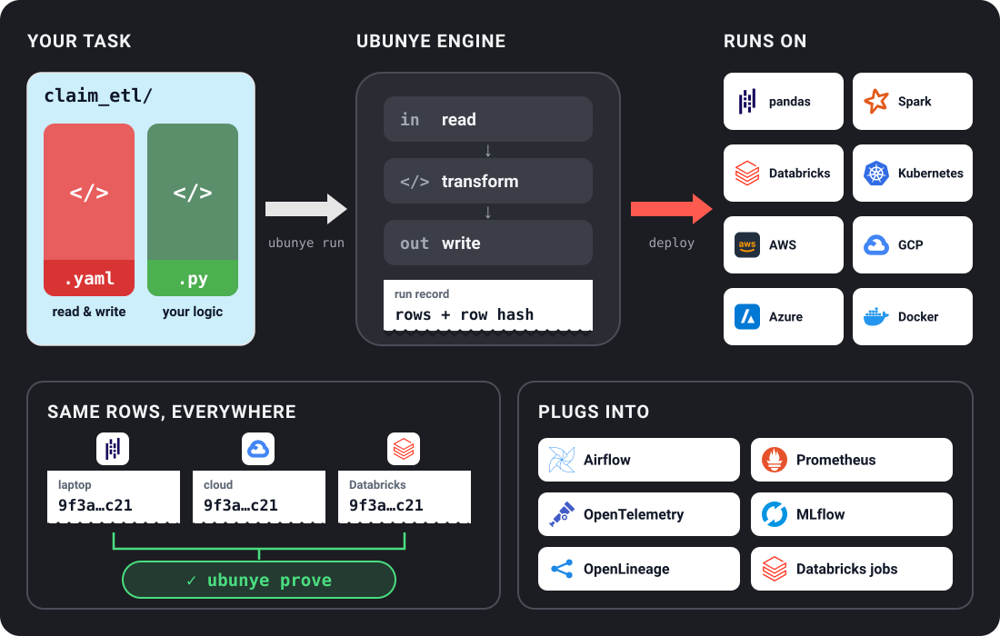

<p align="center">
  
</p>

<p align="center">
  <em>Ubunye (oo-BOON-yeh): isiZulu for "unity"</em>
</p>

<h3 align="center">One framework. Every pipeline. Any environment.</h3>

<p align="center">
  <a href="https://ubunye-ai-ecosystems.github.io/ubunye_engine/">Docs</a> •
  <a href="#docs">Docs map</a> •
  <a href="#try-it">Try it</a> •
  <a href="https://github.com/ubunye-ai-ecosystems/ubunye_engine/discussions">Community</a>
</p>

<p align="center">
  
</p>

---

A **data pipeline** moves data from one place to another (a database to a file, a REST
API to a data warehouse) and usually changes it on the way. Most of the work is
plumbing: connections, credentials, a framework's quirks, the same read, transform,
write scaffold again and again.

**Ubunye Engine writes that plumbing for you.** You describe what to read and write in a
short YAML file and put your change to the data in a normal Python class. Ubunye does the
connections, the compute engine (Apache Spark, or pandas on a laptop with no Java) and the
read and write loop. The same folder runs on your laptop today and on a cluster tomorrow,
with no code changes.

What you get:

- **One standard layout.** Every project is use case, pipeline, task, run by one CLI.
  The words are explained in [Concepts](https://ubunye-ai-ecosystems.github.io/ubunye_engine/getting_started/concepts/).
- **A record of every run.** Each run can leave a run record with a hash of every row
  it read and wrote, so two runs can be compared exactly.
- **Checks before you run.** `ubunye plan` and `ubunye doctor` say what would fail, and
  why, before any data moves. Errors say what went wrong and suggest the fix.
- **Open plugins.** Connectors, backends, model registries and run record stores are
  added from outside, with no engine edits.
- **Types that ship.** The package carries its type information, and a type checker
  guards every merge.

---

## Try it

On a laptop, with no Java and no cloud account:

```bash
pip install "ubunye-engine[pandas]"
```

<!-- quickstart:begin -->
```bash
ubunye init -d pipelines -u demo -p starter -t filter_adults
ubunye plan -d pipelines -u demo -p starter -t filter_adults --backend pandas
ubunye run -d pipelines -u demo -p starter -t filter_adults --backend pandas --lineage
ubunye lineage list -d pipelines -u demo -p starter -t filter_adults
```
<!-- quickstart:end -->

`init` makes a task folder with a sample CSV, `plan` checks it without moving data, `run`
writes Parquet and keeps a run record, and `lineage list` shows that record. The test
suite runs these four commands exactly as written. What each one did, and how to run the
same folder on Spark: the [Quickstart](https://ubunye-ai-ecosystems.github.io/ubunye_engine/getting_started/quickstart/).

---

## Docs

The full docs live at
[ubunye-ai-ecosystems.github.io/ubunye_engine](https://ubunye-ai-ecosystems.github.io/ubunye_engine/).
These are the pages most people need:

| You want to | Read |
|---|---|
| Install it | [Installation](https://ubunye-ai-ecosystems.github.io/ubunye_engine/getting_started/install/) |
| Run a first task | [Quickstart](https://ubunye-ai-ecosystems.github.io/ubunye_engine/getting_started/quickstart/) |
| Learn the words (use case, pipeline, task, profile, run record) | [Concepts](https://ubunye-ai-ecosystems.github.io/ubunye_engine/getting_started/concepts/) |
| Write a `config.yaml` | [Config overview](https://ubunye-ai-ecosystems.github.io/ubunye_engine/config/overview/), then [Inputs and outputs](https://ubunye-ai-ecosystems.github.io/ubunye_engine/config/io/) |
| Check the data a task writes | [Expectations](https://ubunye-ai-ecosystems.github.io/ubunye_engine/config/expectations/) |
| Read what a run did (the run record) | [Lineage commands](https://ubunye-ai-ecosystems.github.io/ubunye_engine/cli/#ubunye-lineage) and [the run record](https://ubunye-ai-ecosystems.github.io/ubunye_engine/architecture/adr-006-run-record/) |
| Run on pandas or Spark | [Execution backends](https://ubunye-ai-ecosystems.github.io/ubunye_engine/backends/) |
| Look up a command | [CLI reference](https://ubunye-ai-ecosystems.github.io/ubunye_engine/cli/) |
| Call it from Python or a notebook | [Python API](https://ubunye-ai-ecosystems.github.io/ubunye_engine/api/) |
| Add a language model step | [Language model steps](https://ubunye-ai-ecosystems.github.io/ubunye_engine/patterns/llm/) |
| Copy a working example | [Examples](https://ubunye-ai-ecosystems.github.io/ubunye_engine/examples/) |
| Read from or write to a system | [Connectors](https://ubunye-ai-ecosystems.github.io/ubunye_engine/connectors/overview/) |
| Deploy it | [Deployment](https://ubunye-ai-ecosystems.github.io/ubunye_engine/deployment/) |
| Fix something that went wrong | [Troubleshooting](https://ubunye-ai-ecosystems.github.io/ubunye_engine/troubleshooting/), then [Errors](https://ubunye-ai-ecosystems.github.io/ubunye_engine/errors/) |
| Move from 0.8 to 0.9 | [Upgrading](https://ubunye-ai-ecosystems.github.io/ubunye_engine/upgrading/) |
| See what changed | [Changelog](https://ubunye-ai-ecosystems.github.io/ubunye_engine/changelog/) |

Worked examples, grouped by where they run (Databricks, a laptop, Docker, Kubernetes),
live in [**ubunye-examples**](https://github.com/ubunye-ai-ecosystems/ubunye-examples).

---

## Proof

One task, unchanged, gave the same rows on pandas (no Java), local Spark, Kubernetes,
AWS Glue, GCP Dataproc, Azure Container Apps and Databricks: the same data hash in all
seven, compared from their run records by `ubunye prove`. See the
[latest results](https://ubunye-ai-ecosystems.github.io/ubunye_engine/proving-ground/latest/).

---

## What Ubunye is not

- Not an agent framework: use LangChain or CrewAI for that.
- Not an orchestrator: use Airflow, Prefect or Dagster (`ubunye export` writes an Airflow
  DAG or a Databricks job for you).
- Not a compute engine: it runs on Spark, or on pandas for laptop-sized data.

Ubunye is the **standard layer** between your data sources and your applications. It
makes the plumbing boring so you can focus on what matters.

**Not yet:** data drift detection is a pattern you write in a task, not a built-in
feature. EMR Serverless is built but has not run the proving workload, and Hadoop/YARN is
not tested. Neither is claimed until a run says so.

---

## Get involved

New connectors, bug fixes, typos, or just telling us what you are building: all help.

- [Report a bug](https://github.com/ubunye-ai-ecosystems/ubunye_engine/issues)
- [Request a feature](https://github.com/ubunye-ai-ecosystems/ubunye_engine/discussions)
- [Read the contributing guide](CONTRIBUTING.md)
- Star the repo if you find it useful; it helps more than you'd think

## License

[MIT License](LICENSE)

---

<p align="center">
  Built with 🇿🇦 by <a href="https://github.com/ubunye-ai-ecosystems">Ubunye AI Ecosystems</a>
</p>
