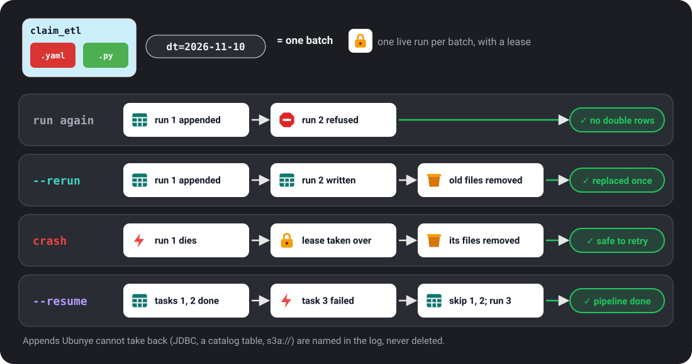

# ADR 008: A rerun is safe: one live run per batch, appends land once

**Status:** accepted (hardening programme, 2026-09-29)

!!! abstract "Current rule (summary)"
    The decision below and its four addenda, as they stand today (0.9.0):

    - **One live run per batch.** A batch is a task plus all its variables (`dt`, `dtf`,
      `--var`, the profile). A second run of a batch that is still running is refused in
      one line, exit 1. Different batches never block each other.
    - **A dead run is taken over.** If its process is gone, or its lease file has not
      been touched for 15 minutes, the next run of the batch takes over and marks the
      dead run's record `interrupted`.
    - **Appends that were claimed are taken back** when a run fails or dies: on pandas,
      and on Spark for file formats on a local or shared disk (written into a staging
      folder, then claimed and moved in).
    - **A finished batch is not appended twice.** A new run of a finished batch whose
      task appends is refused. `--rerun` replaces what the finished run wrote;
      `--resume` runs only the pipeline's tasks that have not finished the batch.
    - **Delta appends land once.** A plain Delta append uses Delta's own idempotent
      write, so a retry commits nothing. With `replace_where`, every run replaces the
      batch's rows, so a rerun can correct them.
    - **JDBC appends with `replace_where` land once:** staged, then moved in by one
      database transaction (delete the batch's rows, insert the new ones).
    - **What cannot be taken back is named, never deleted:** plain JDBC appends,
      non-Delta catalog tables, and Spark appends to object storage or HDFS. Use
      `overwrite`, `overwrite_partitions`, `merge` or `replace_where` for batches that
      must land once.
    - **Scope:** the lease protects runs that share the use case folder (one machine or
      a shared disk), not cloud jobs that each start on their own disk.
      `UBUNYE_RUN_LEASE=off` turns it off.

    How to use it: [Safe reruns](../guides/safe-reruns.md).

## Context

A pipeline run can stop at any moment: a power cut, a killed job, a failed write. What
matters is what the next run does. The hardening experiments measured it:

- E-01: a run killed after committing an `append` output was appended again by the
  rerun, in 16 of 16 trials: the batch landed twice, silently (finding F-011).
- E-02: two runs of the same task and date at once both succeeded and appended twice in
  7 of 10 pairs (F-019); when they started together the loser failed with a raw OS error
  (F-020).
- A killed run's record said `running` for ever (F-013).

The AbsaOSS ingestion tool Pramen met these in production and answered with a lease per
table and information date, and with repairs made from what was actually written.

## Decision

- **A lease per batch.** A run takes a lease on its task and its variables (`dt`,
  `--var`): the batch. The lease is a file under `<usecase_dir>/.ubunye/leases/`,
  created atomically, naming the run, its process, host and a heartbeat. A second run of
  the same batch while the first lives is refused (`RunLeaseHeld`), naming the first.
  Runs of different batches never block each other.
- **A dead run is taken over.** A lease whose process is gone (same host, checked by
  pid and process start time, so a reused pid is not mistaken for it), or whose file
  has not been touched for 15 minutes by the shared disk's own clock (another host, so
  no two clocks are compared), belongs to a dead run. The next run takes it over, marks
  that run's record `interrupted`, and takes back its claimed appends.
- **Only claimed files are ever removed.** A backend that names the files it appends
  *claims* each one in the lease before it lands. The pandas backend does: one part
  file with a fresh UUID in its name (one per partition folder for a partitioned
  append, F-012), each moved into place in one step. So does Spark for a path on a
  local or shared disk (F-070, addendum below). A run that
  fails removes its claimed files; the run that takes over a dead run removes that
  run's. No output folder is ever listed to decide what to delete, so another run's
  files are never touched.
- **What cannot be claimed is named, never deleted.** JDBC, catalog and Delta
  appends, and Spark appends to object storage, are not claimed. If such a run fails or dies after appending, the log and the dead
  run's record say which outputs may hold part or all of the batch. A missing `mode`
  counts as append, since most writers default to it.
- **A claim is never forgotten.** A claimed file that cannot be removed (a reader has
  it open, common on Windows) stays in the lease, and the lease stays: the next run
  takes it back, or refuses and names the file. Claims are kept relative to the
  usecase folder, so a host that mounts the shared disk elsewhere finds them.
- **A run that lost its lease stops, and is never a success.** Every output and every
  claim is recorded in the lease before anything lands, and only while the lease is
  this run's. A takeover holds the lease for a moment before taking anything back (a
  run judged dead that writes its lease again is alive, and is left alone), and leaves
  a mark naming the run it took over. A run that finds that mark stops; if it gets as
  far as the end, its record says `interrupted`, not `success`. A lease is only ever
  created, never overwritten, including when a mistaken takeover puts one back.
- **A refusal is not a crash.** `ubunye run` prints one line naming the run that holds
  the batch and exits 1, with no traceback. The hint says not to delete the lease of a
  run that may be alive: it holds that run's claims.
- **On by default.** `UBUNYE_RUN_LEASE=off` turns it off.

## What it does not do, said plainly

- The batch is the task and **all** its variables. A rerun of the same `dt` with a
  different `dtf`, `--mode` spelling or an extra `--var` is a different batch: it is
  not refused while the first runs, and it does not take back a dead run's claims.
  Rerun a batch with the same variables.
- A successful run that is killed after its success is recorded, but before it marks
  its lease done, is still treated as finished when lineage is on (its record says
  `success`). With lineage off, that narrow window can have its appends taken back by
  the next run of the batch, which then writes the batch itself.
- On macOS a process's start time is not read, so a dead run whose pid was reused
  keeps its lease looking alive until that process ends.
- The lease protects runs that share the usecase folder: one machine, or a shared
  disk. Cloud jobs that each start on their own disk are not protected by it; a lease in
  object storage (a conditional write) is the next step.
- Appends are taken back on the pandas backend, and on Spark for plain file formats
  on a path Spark resolves to the local file system (F-070). A Spark append to object
  storage (`s3a://`, `abfss://`, `gs://`, `dbfs:/`), HDFS, a non-Delta catalog table,
  or JDBC is named after a crash, not repaired: use `overwrite`,
  `overwrite_partitions`, `merge` or Delta's `replace_where` for batches that must land
  once (F-072, F-073). A Delta append lands once by Delta's own idempotent write (F-071,
  addendum below).
- A run of a batch that already **finished** is covered by the addendum below (F-031),
  not by the lease, which is gone once a run ends.
- It does not make a whole run exactly-once for outputs other than appends: an
  `overwrite` output was already safe (E-01, E-02: correct in every trial), since it is
  replaced in one step.

## Consequences

- E-01 rerun (20 hard kills): 19 of 20 exactly right; the one wrong trial was F-031
  (the killed run had already finished). No debris, no `running` record left.
- E-02 rerun: 0 of 10 doubled (7 of 10 before); every second run refused in one line
  naming the first.
- A fourth review found a successful run's lease left behind by a Windows file lock
  (the next run then took back committed data), a file landing after a takeover, an
  orphan whose file was in use, and a claim made through a drive letter. Each is fixed
  (a separate done marker, a check after each file lands, a refusal, real paths) and
  has a unit test.
- On Windows a lease file is refused for a moment while it is replaced, and a replace
  is refused while a reader has the file open (F-048). Every lease read, stat, rename
  and removal retries a `PermissionError` for up to 2 seconds. A missing file is
  never waited for, and it is still absent.
- **A file that exists but cannot be read is never absent, free or dead** (F-048
  skeptic review). If a lease, a dead run's lease left beside it, the finished note
  or a dead run's record still cannot be read after the retries, the run is refused
  and names the file. A takeover that cannot read the lease it renamed puts it back.
  A finished note that is not valid JSON is refused too: it is written in one
  replace, so something else changed it. One exception: a lease that is empty or not
  valid JSON is judged by its age, as before, since a crash inside its creation
  leaves one, and it names no process and claims nothing.
- Three adversarial reviews shaped this. The third found no way to delete another
  run's file, and proved two silent doubles (a claim forgotten when its file was in
  use; a claim not found from another mount), a heartbeat that stopped for good, and a
  run frozen mid-save that kept going after a takeover. Each has a unit test.
- Two earlier versions worked out a run's files by listing the output folder (all new
  files, then new files between before and after the write). Adversarial reviews
  proved, by script, that both delete another run's committed append when two batches
  share a folder. Claims made by the writer are the answer: ownership is stated by the
  code that created the file, never inferred.
- **Behaviour change:** a run that fails now removes the appends it wrote; a run of a
  batch that is already running is refused rather than run.
- A `.ubunye/leases/` folder appears next to `.ubunye/lineage/`.

## Addendum: a finished batch (F-031, 2026-09-29)

E-01 caught a second full run of a finished batch appending it again. Three answers
were on the table: skip it (Pramen's default for a date already done), refuse it, or
replace it.

**Decision: refuse by default; `--rerun` replaces.**

- A run of a *named* batch (`dt` or a `--var`; `mode` and `dtf` alone name nothing)
  that succeeds leaves `<key>.finished.json` beside its lease: the run, the outputs
  it wrote and the append files it claimed. An overwrite is noted too, since it wrote
  the batch. A later run of that batch, whose task has an append output, is refused
  (`BatchFinished`, a `RunLeaseHeld`: one line, exit 1).
- **Resuming a pipeline is asked for by name.** `run --resume` (`run_pipeline(...,
  resume=True)`) skips the tasks that finished the batch and runs the rest. Skipping
  by default was tried and rejected: in an hourly pipeline (same `dt`, `t1` appends,
  `t2` overwrites) it dropped `t1`'s new rows and exited 0 (skeptic round 6).
- **The note is written before anything is replaced.** If it cannot be written (a
  reader has it open), the run keeps its lease as it is and removes nothing; the next
  run of the batch writes the note first, then removes the replaced files, or waits.
- `--rerun` (`rerun=True`) replaces the batch. The finished run's claimed files are
  listed in the new lease as `replaces` and removed only after the new run has
  committed: done mark, then the new note, then removal. A crash before the done mark
  keeps the old batch (the new files are taken back as usual); a crash after it is
  finished by the next run, which removes the listed files. Files in use keep the
  lease, as for claims. A run whose lease was taken over before it saved `committed`
  removes nothing and is not a success (skeptic round 5 proved the earlier order
  deleted both runs' files).
- Appends that were never claimed (JDBC, catalog and Delta tables, Spark on object
  storage) cannot be replaced: with `--rerun` they are appended again and the run says
  so, naming the outputs.

**Why not skip.** A skip exits 0 and writes nothing. A job that runs `dt=today`
every hour and appends new rows each time would then lose every run after the
first, silently. A refusal fails loudly and loses nothing; its hint names both
ways forward (`--rerun`, or a variable per run such as `--var hour=13`).

**Why not replace by default.** The same hourly job would then delete the morning's
rows at noon. Replacing is right for a backfill and wrong for that job, so it is
asked for by name.

**Not refused:** a run with no named batch (a snapshot job, where every run is the
same key), a task whose outputs all overwrite (already safe), and batches finished
before this change (they left no note). Cloud jobs on their own disks see no note,
as they see no lease. Notes are small and are kept, one per task and batch; nothing
removes them. `--rerun` replaces the files the finished run claimed wherever they
are, even if the output's path has changed since. Files moved or compacted by
something else since are not found, so `--rerun` then removes nothing and appends
(the log says how many files it removed). `dtf` stays part of the batch key:
dropping it would strand leases left by earlier versions.

## Addendum: Spark path appends are claimed (F-070, 2026-09-30)

A Spark `append` to a folder of files was named after a crash, never taken back. On
live Spark 4.2 a run killed after its append was appended again by the rerun, a run
that failed after its append left it there, and `--rerun` appended a finished batch a
second time (9 of 10 new integration cases fail on the old code).

**Why Spark cannot claim its own files.** Spark names each file
`part-NNNNN-<job uuid>.c000<ext>` with a job UUID it makes inside the write
(`InsertIntoHadoopFsRelationCommand`, the same in Spark 3.5.8 and 4.0.1). No option
sets it. When the files appear in the output depends on the committer: at job commit
with `FileOutputCommitter` v1, at each task commit with v2, and a failed v2 job leaves
files behind. So no claim can be made before Spark's files land in the output.

**Decision: Spark writes into a staging folder the lease names, then the files are
claimed and moved in.**

1. The run records a new folder inside the output, `_ubunye-<12 hex>`, in the lease,
   and marks the output as claimed exactly. The folder does not exist yet. The
   output folder is made if it is missing, as Spark's append makes it.
2. Spark writes the batch into that folder (partition folders included), in a job
   group of its own.
3. The data files in it are this run's by construction: the run named the folder and
   nothing else writes there. Their names are claimed in the lease, all in one save.
4. Each is moved up into the output in one rename (the same folder tree, so the same
   disk), and checked as landed: one check of the takeover mark per file, and one
   full read of the lease after the last. `_SUCCESS` is touched in the output, as
   Spark's own append leaves it.
5. The staging folder is removed. A run that fails, or the run that takes over a dead
   one, removes the staging folder named in the lease and the claimed files, nothing
   else.

**Why this is not inferring ownership.** The rule is unchanged: the writer states
what is its own. What is listed is a folder this run named and recorded before it
existed, not the output. The output folder is never listed. A file already in the
output with the same name as one of the run's files is refused before anything is
claimed, so a claim can never name a file that is not this run's.

**Which appends.** A run lease is held; the format is `parquet`, `csv`, `json`,
`orc`, `avro` or `text`; and Spark resolves the path to the local file system (a
laptop, a VM disk, a shared mount; a path with no scheme on a cluster whose default
file system is HDFS is not local). Everything else goes to Spark directly, as before,
and is named after a crash; the log says in one line which output and why. What
Spark itself skips is not moved: `.crc` checksums, `_SUCCESS`, and Parquet summary
files, which describe the staging folder only.

**Why inside the output.** The first version put the staging folder beside the
output. The skeptic review proved three faults with it: an output that is a junction
or mount on another disk could not be renamed into (WinError 17, EXDEV); an output
folder name of about 235 characters or more made the staging name longer than 255;
and a glob of the parent folder (`lake/*`, polars `**`) read the staged batch. Inside
the output, with a leading `_`, it is on the same disk, 20 characters long, and
skipped by Spark (`shouldFilterOutPathName`, partition discovery included: it has no
`=`), pyarrow, pandas and Ubunye's own reader, as Spark's own `_temporary` is. A
staging folder left in the output (a run interrupted in a way no lease could record)
is named in a warning by the next append, never removed. A job that overwrites the
whole output while an append is being written removes the staging folder with it;
that append then fails and is taken back.

**What it costs.** One rename and one stat per file, one lease save for all the
claims and one full lease read at the end. Claiming 12,000 files takes 14.5 s on the
dev box, most of it the file system (it was 76 s when each file re-read the lease,
which grows with each claim; skeptic review). Spark writes the same data either way.

**An interrupt.** Ctrl+C during Spark's write cancels the write's job group before
the staging folder is removed. A task that was already writing when the cancel
arrived may still put a file in the folder a moment later; that folder is then left
in the output (skipped by readers, named by the next append).

**No false alarms.** An output written through a staging folder counts as fully
taken back even when it claimed nothing: nothing reaches the output unclaimed, so no
claims means nothing landed (a name clash refused, a kill before the claims, Spark
failing). An exact output with neither is still named, since a custom writer on a
claiming backend may append without claiming.

**Not covered, filed:** Delta appends (F-071: Delta's `txnAppId` and `txnVersion`
make a write idempotent, but they also skip a deliberate `--rerun` and a rerun after
the rows were removed by hand, silently); JDBC appends (F-072); Spark appends to
object storage and HDFS (F-073: a rename there is a copy, and a take back needs the
Hadoop file system, which a run that takes over may not have started).

**Proof:** `tests/integration/test_spark_append_claims.py` (E-01 and E-02 ported to
Spark: a real kill of a child process after the append and before the claims, a
foreign file in the folder, `--rerun`, four formats partitioned, a failed run, two
runs at once). On the old code 9 of 10 fail (the batch twice, or a failed run's
append left); on the new code 10 of 10 pass. Two runs at once was already safe (the
lease refused the second) and passes on both. The skeptic review added four cases
(readers of the output and its parent, flat and partitioned; an output on another
disk; a 240 character output name): all four fail on the first version and pass now.
Its crash matrix (7 kill points, flat and partitioned, each followed by another
batch, a takeover, `--resume` and `--rerun`, with a foreign file and decoy staging
folders) found no file deleted or doubled that the run did not own, before or after
the move inside.

## Addendum: a Delta append lands once, and a rerun can correct it (F-071, 2026-11-10)

A Delta append is one commit, so its files cannot be claimed (moving files behind
Delta's log corrupts the table). On live Spark 4.2 with delta-spark 4.4, a run
killed after its commit was appended again by the rerun, a run that failed after it
left its rows for the rerun to add again, and `--rerun` appended a finished batch a
second time (8 of 9 new integration cases fail on the old code). A production job
that pays customers bypassed the writer with a hand-written insert-only MERGE for
this: safe to rerun, but a bad month could never be corrected.

**Decision: Delta's own idempotent write for a plain append; `replace_where` names
the batch's rows for a correctable one.** Under a run lease with a named batch:

- An append with no `replace_where` carries `txnAppId` (`ubunye/<task>/<output>/<batch
  key>`) and `txnVersion` 0. Delta skips a write whose app id already committed that
  version, so a retry of the batch commits nothing (probed: path, new path, catalog
  table, new catalog table). The run compares the table version before and after;
  if it did not move, it warns that the batch was already there and how to replace
  it. That answers F-071's objection that the skip is silent.
- An append with `replace_where` is written as `overwrite` with `replaceWhere`: one
  commit replaces the batch's rows, on every run, from the current data. It carries
  no `txnAppId`: a replace is idempotent by itself, and a key would skip a
  deliberate correction. Delta refuses rows outside the predicate
  (`DELTA_REPLACE_WHERE_MISMATCH`), so a wrong predicate fails, never deletes
  another batch. `replace_where` on an append was ignored before; it is the opt in.
- `--rerun` of a finished batch: with `replace_where` it replaces (the refusal hint
  says so); without it the batch is appended again, as before, and the run warns at
  its start, now naming `replace_where`. A second plain run of a finished batch is
  still refused, for the hourly-job reason in the F-031 addendum.
- The lease notes such an output as `idempotent` (`once` or `replaces`). It is not
  named as unrepaired after a crash or failure, since its rerun does not add it
  twice; a failed run says which outputs keep its batch and what the rerun does.

**Why the key is the batch, not a version per rerun.** A version Ubunye bumps would
have to be kept somewhere a cloud job on its own disk can read, and would skip a
second correction when it is lost. Version 0 per batch needs no state: everything
that must change a batch goes through `replace_where`.

**Not covered.** A run with no named batch, or with no lease (`UBUNYE_RUN_LEASE=off`),
appends plainly, as before (`replace_where` still replaces). A config that sets its
own `txnAppId` or `txnVersion` is left alone. Delta drops a `SetTransaction` after
`delta.setTransactionRetentionDuration` when a table sets it; a retry after that
appends again. Non-Delta catalog tables and Spark on object storage stay as they
were (F-073).

**Proof:** `tests/integration/test_delta_append_reruns.py` (a real kill of a child
after the commit; a failed run on a path and through the `delta`, `hive` and
`unity` writers into a catalog table; `--rerun` with `replace_where` on a path and a
table; a failed run corrected by the next; rows removed by hand reported; a run
with no batch appends each time). 8 of 9 fail on the old code (the ninth pins
unchanged behaviour); 9 of 9 pass. Bookkeeping: `tests/unit/core/test_batch_write.py`.

## Addendum: a JDBC append with `replace_where` lands once (F-072, 2026-11-10)

Spark's JDBC writer commits each partition in a transaction of its own: a run that
dies part way leaves part of the batch, and nothing says which part. There are no
files to claim, and no batch id in the table unless the user put one there.

**Decision: opt in with `replace_where`; staged, then moved in by one database
transaction.** For an append output that sets it, Spark writes the batch into
`ubunye_stage_<12 hex>` beside the target (named by the task, output and batch
under a lease, so a retry replaces a staging table a killed run left behind). Then
one transaction runs `DELETE FROM <table> WHERE <replace_where>` and
`INSERT INTO <table> (<columns>) SELECT <columns> FROM <stage>`, and commits; the staging table
is dropped afterwards. A kill before the commit changes nothing in the target; a
kill after it leaves the batch, which the rerun replaces with the same rows. The SQL
is plain and portable; identifiers are quoted by Spark's own dialect for the URL.
The lease notes the output as `idempotent: replaces`.

**Why not generic.** A plain JDBC append has no way to name a killed run's rows.
Options considered: a pre-delete then Spark's append (two transactions, a kill
between them loses the batch until the rerun), or a ledger table of batches in the
user's database (exactly once without a predicate, but it writes a table the user
did not ask for). Neither is worth it while `replace_where` gives exactly once with
one key the user already knows. A plain JDBC append is unchanged and still named
after a crash.

**Limits.** Needs a classic Spark session (a JVM; Spark Connect is refused with a
clear error) and a database user that may create and drop a table in the target's
schema. The predicate is in the database's SQL dialect. DDL inside a transaction is
not needed: only the `DELETE` and `INSERT` are in it.

**Proof:** `tests/integration/test_jdbc_append_reruns.py` on Apache Derby embedded
in memory (its jar ships with Spark). 3 of 4 fail on the old code; 4 of 4 pass.
