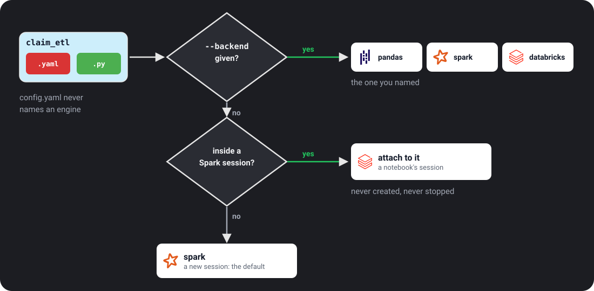

# Execution backends

A backend is the engine that runs your task. The task folder never names one,
so the same folder runs on any backend that can do what it asks.



## See what you have

```bash
ubunye backends
```

```text
databricks
  features:     catalog, partitioned_writes, path_io, records, remote_paths, spark
  file formats: any
  write modes:  any
  distributed:  yes   needs Java: yes
pandas
  features:     partitioned_writes, path_io, records
  file formats: csv, json, parquet
  write modes:  append, errorifexists, ignore, overwrite, overwrite_partitions
  distributed:  no   needs Java: no
spark (default)
  features:     catalog, partitioned_writes, path_io, records, remote_paths, spark
  ...
```

Add `--json` for a machine readable list.

## Choose one

| Where | How |
|---|---|
| CLI | `ubunye run ... --backend pandas` (also `test run`; `validate` and `plan` take it to check without running) |
| Python | `ubunye.run_task(task_dir, backend="pandas")` (also `run_pipeline` and `notebook`) |

With no choice, Ubunye uses the platform's session if there is one (on
Databricks, the notebook's), and otherwise starts Spark.

## Check before you run

```bash
ubunye validate -d pipelines -u sales -p etl -t daily --backend pandas
```

This checks every input and output against what the backend can do, without
starting anything, and lists every problem at once:

```text
  [FAIL] daily (on the pandas backend)
         - input 'orders' uses the 'hive' connector, which needs spark; the pandas backend does not provide it.
         - output 'report' uses mode 'merge'; the pandas backend can do append, errorifexists, ignore, overwrite, overwrite_partitions.
```

`ubunye run` makes the same check before it starts, so a task that cannot run
stops in the first second, not halfway through.

## The shipped backends

| Backend | Use it for | Install |
|---|---|---|
| `spark` | Local Spark, Kubernetes, EMR, Dataproc, spark-submit, CI. Starts its own SparkSession, or attaches to the one spark-submit made | `pip install 'ubunye-engine[spark]'` |
| `databricks` | Reuses the SparkSession that already exists instead of making one (chosen for you on Databricks) | included in the runtime |
| `pandas` | Small data on a laptop, CI, teaching: pandas and pyarrow, no Spark and no Java. Reads and writes local csv, json and parquet exactly as Spark does | `pip install 'ubunye-engine[pandas]'` |

The pandas backend reads and writes exactly as Spark does: see
[How the pandas backend reads and writes](#how-the-pandas-backend-reads-and-writes).
The [REST connector](connectors/rest_api.md) runs on it too (the `records` feature),
with the same rows and types as on Spark.
Its frames have Arrow backed columns, which makes a big `merge` slower on pandas 3;
[Big merges on Arrow columns](#big-merges-on-arrow-columns)
says when that matters and the three lines that fix it.

## One transform for every engine

The config runs anywhere; the transform runs where its code does. A transform
that calls the Spark API (`F.col`, `groupBy`) needs a Spark backend, and one
written with pandas needs the pandas backend. To run the same task on both,
write the transform once with [Narwhals](https://narwhals-dev.github.io/narwhals/)
(`pip install narwhals`):

```python
import narwhals as nw

from ubunye.core.interfaces import Task


class SurvivalByGroup(Task):
    def transform(self, sources):
        people = nw.from_native(sources["titanic"])  # pandas or Spark, as given
        summary = (
            people.with_columns(
                age_group=nw.when(nw.col("Age") < 18).then(nw.lit("child")).otherwise(nw.lit("adult")),
                # Spark widens every sum to a 64 bit integer; pandas keeps the
                # column's type. Cast first and both give the same type.
                Survived=nw.col("Survived").cast(nw.Int64),
            )
            .group_by("Pclass", "age_group")
            .agg(nw.len().alias("passengers"), nw.col("Survived").sum().alias("survivors"))
            .sort("Pclass", "age_group")
        )
        return {"summary": summary}  # returning the Narwhals frame is fine
```

Run it with `--backend pandas` and on Spark, and the two run records carry the
same data hash: the same rows, values and types (the engine's own tests check
this against Spark). The engine hands your transform its own frames and
unwraps what you return, so writers, hooks and lineage never see Narwhals.

Narwhals gives one API, not one set of engine rules. Two differences are known:

- **A sum of whole numbers** is `bigint` on Spark and keeps the column's type on
  pandas (`int32` for small numbers read from CSV). Cast the column before the
  group by, as above. (Casting inside `agg` works too, but pandas then runs the
  sum the slow way, and Narwhals warns.)
- **Rounding a value exactly halfway**: Spark rounds half up and pandas rounds
  half to even, so `round(2)` makes 0.125 into 0.13 on Spark and 0.12 on pandas.
  Other values round the same. Round for presentation, or where ties cannot
  occur.

The run record's data hash covers every value and type, so comparing the two
runs' hashes (`ubunye lineage compare`) shows whether a transform really gives
the same result on both.

You do not declare which engines a transform supports. `ubunye plan` reads the
imports in `transformations.py` and says what it is written for:

```text
  Transform  SurvivalByGroup  (transformations.py), written for narwhals
```

and with `--backend pandas` on a transform written for pyspark it warns before
the run instead of failing on the first line. Why it works this way, and why
SQL is not the answer yet: [ADR 005](architecture/adr-005-portable-transforms.md).

## How the pandas backend reads and writes

The pandas backend runs a task with pandas and pyarrow: no Spark and no Java.
Use it for small data, local development, CI and teaching:

```bash
ubunye run -d ./pipelines -u sales -p etl -t daily --backend pandas
```

The same `config.yaml` drives it. Reads and writes go through the generic `s3`
path connector for the formats pandas understands (csv, parquet, json);
lakehouse formats (delta) and managed tables need Spark, and the engine says so
rather than failing obscurely. The one caveat is your own logic: a
`transformations.py` that calls the Spark DataFrame API needs Spark, so a task
can run on pandas when its transform works on both (see
[One transform for every engine](#one-transform-for-every-engine)) or is written
in pandas. Install the extra with `pip install "ubunye-engine[pandas]"` (on
Windows it asks for pyarrow 24 or newer, the first that handles time zones
there). Check a task can run on it first with `ubunye validate ... --backend pandas`.

### It reads data the way Spark does

The same folder must give the same data on both backends, so the pandas backend
copies Spark's defaults instead of pandas' own:

| What you read | What you get (same as Spark) |
|---|---|
| CSV, no options | No header: the first line is data, columns are `_c0`, `_c1`, ... |
| CSV with `header: "true"` | Columns named from the first line, every value as text. A blank name becomes `_c<position>`; a repeated name (ignoring case) gets its position added to each copy, so `a,a,,A` reads as `a0, a1, _c2, A3` |
| CSV with `inferSchema: "true"` | Spark's rules, over every file at once: `int` if every value fits, else `bigint`, a whole number past 64 bits, or one written `5.` or `1.5E1`, a `decimal` (read exactly); digits in any script count; `double` (Java's forms: `1.5d`, ` 2` with a space, `Inf`, `NaN`; but `inf` is text), `boolean` in any case, `date`, `timestamp` (with or without an offset); an empty column is text |
| An empty CSV field | null, not an empty string (also when `nullValue` is set to other text) |
| A CSV value of any length | Read whole (Spark has no limit; pyarrow alone stopped past 1 MB) |
| `encoding` (csv, json) | One of the names Spark 4 accepts: `UTF-8`, `ISO-8859-1`, `US-ASCII`, `UTF-16`, `UTF-16LE`, `UTF-16BE`, `UTF-32` (any case). Others (`cp1252`, `latin1`, `utf8`) are refused, as Spark 4 refuses them; Spark 3.5 took any Java name |
| A CSV byte that is not valid in `encoding` (UTF-8 unless set) | The character U+FFFD, one per broken sequence exactly as Java decodes it (an encoded surrogate, `ED A0 80`, is one); the read goes on |
| Quotes in a CSV value | Spark's escape is a backslash, so `"Anna ""Annie"""` stays exactly as written, and `"a\"b"` is `a"b` (set `escape: '"'` for doubled quotes); a line of only spaces is skipped |
| JSON | One object per line (`multiLine: "true"` for one big array); columns and nested fields sorted by name; whole numbers are `bigint` (`decimal` past 64 bits); a field that is a number in one record and text in another is text, and a value read as text keeps its JSON (one object per line: its exact source text, `1.50` stays `1.50`, as Spark 4 reads it; `multiLine`: as Jackson writes it back, `1.5`, as Spark 3.5 does always); records whose names differ only by case merge into the names seen first (as Spark does; the other spelling then reads as null); a record that repeats a key is refused; empty names and empty objects are dropped, and a record left with no fields is still a row; dates stay text |
| Parquet with unsigned columns | `uint8` as `smallint`, `uint16` as `int`, `uint32` as `bigint`, `uint64` as `decimal(20,0)`: Spark has no unsigned types |
| A folder | Every data file in it, skipping `_SUCCESS` and other `_` or `.` files and empty files, so it reads what Spark wrote |
| A partitioned folder (`dt=2024-01-02/...`) | The partition columns, after the data columns, typed as Spark infers them (see below) |
| A glob such as `data/*.csv` | Every matching file |
| Column names that differ only by case (`Col`, `col`) | Refused, on read and on write, as Spark refuses them by default |
| `schema: "id INT, name STRING"` | Exactly those columns and types; an empty file or a folder with no data files gives zero rows of them |
| `mode: "FAILFAST"`, `"DROPMALFORMED"`, `"PERMISSIVE"` | What Spark does with a bad row: stop, skip it, or (the default) cut a row with too many fields and pad one with too few |

The frame your task gets is an ordinary pandas DataFrame whose columns are backed
by Arrow, so a whole number column with gaps stays whole numbers and a decimal
stays a decimal, just as in Spark. Write plain pandas and return plain pandas:

```python
class Enrich(Task):
    def transform(self, sources):
        orders = sources["orders"]
        return {"report": orders.assign(total=orders["price"] * orders["qty"])}
```

Timestamps written as text are read in `spark.sql.session.timeZone` from your
`ENGINE.spark_conf`, the same setting Spark uses. If it is not set, the pandas
backend uses UTC on every machine, while Spark would use the machine's own zone.
Set it once and the two backends agree. A wall clock time that the zone skips
(02:30 on the night clocks go forward) is read an hour later, and one that happens
twice (01:30 on the night clocks go back) is read as the first of the two, as Java
and so Spark read them.

### Big merges on Arrow columns

Arrow backed columns cost you speed in one place: `merge`. On pandas 3, a merge
on an `int64[pyarrow]` key is about 2.8 times slower than the same merge on a
NumPy `int64` key. Filters, new columns, `groupby`, reads and writes run at the
same speed. Measured on 5,000,000 rows joined to 900 (median of 3, dev box,
pandas 3.0.6, pyarrow 25):

| Merge on `region` | Seconds |
|---|---|
| Arrow keys, as the transform gets them | 0.97 |
| NumPy keys (`pd.read_parquet`) | 0.29 |
| Arrow keys, converted with the snippet below first | 0.33 |

In the engine's scale test transform the merge took 0.98 s against
0.35 s, 2.8 times; alone, as above, 3.3 times. On pandas 2.3 the two took about
the same time (0.93 and 0.97 s). Memory goes the other way: at 50,000,000 rows the
whole job peaked at 9.1 GB with Arrow columns and 12.2 GB with NumPy ones. So this is a trade, and most tasks never notice.

If a merge is most of your task's time, convert the join keys yourself, in your
transform, when they are whole numbers with no nulls:

<!-- numpy-keys:begin -->
```python
def numpy_keys(frame, keys):
    """Whole number join keys with no nulls as NumPy int64; the rest as they are."""
    return frame.astype({k: "int64" for k in keys if not frame[k].hasnans})
```
<!-- numpy-keys:end -->

```python
class Detail(Task):
    def transform(self, sources):
        events = numpy_keys(sources["events"], ["region"])
        regions = numpy_keys(sources["regions"], ["region"])
        return {"detail": events.merge(regions, on="region")}
```

It works on pandas 2 and 3, and on both `int64[pyarrow]` and pandas' own nullable
`Int64`. The values do not change, and a key with a null is left alone, so it stays
a whole number column. The written data and its hash in the run record are the
same either way. Convert both sides of the merge: with only one side converted
the rows are still right, but do not count on the speed.

The engine does not do this for you, on purpose. Your transform gets the frames
as they were read ([ADR 004](architecture/adr-004-native-frames.md)), with the
types Spark would give: a whole number column with a null stays a whole number
column. NumPy has no whole number that can be null, so it would turn that column
into floats. Only your transform knows which keys never have nulls, so the choice
is yours.

### It writes data the way Spark does

A path the pandas backend writes looks exactly like one Spark writes: a folder
holding `part-00000-....snappy.parquet` (or `.csv`, `.json`) and a `_SUCCESS`
file. So Spark can read what pandas wrote, and pandas can read what Spark wrote.

- `overwrite` replaces the folder. The new data is written to a hidden folder
  first and swapped in only when it is complete, so a failed run never leaves
  you with half a table.
- `append` adds new part files and leaves the old ones alone.
- `overwrite_partitions` with `partitionBy` replaces only the partitions the
  new data fills (see below).
- CSV is written the Spark way: no header unless `header: "true"`, text quoted
  only when it has to be, numbers such as `2.0` and `1.0E10`, timestamps such as
  `2024-01-02T03:04:05.000+02:00`.
- JSON is one object per line, and null fields are left out. A map column is
  written as an object and keeps its null values (`{"a":null,"b":"x"}`), as Spark
  writes a map.
- Parquet timestamps are stored in microseconds, which is what Spark reads.

### Partition folders

`partitionBy: [dt]` writes Spark's folders, `out/dt=2024-01-02/part-....parquet`,
with every mode, and the same task gives the same folders and rows on both
backends (the engine's tests check this against Spark 4.2). What Spark does,
this does:

- One folder level per column, in `partitionBy` order. Characters a folder name
  cannot hold become `%` codes (`a/b` is `a%2Fb`; on Windows a space is `%20`, as
  Spark writes it there). A null or empty value is `__HIVE_DEFAULT_PARTITION__`.
- The partition columns are not in the data files; reading the folder puts them
  back after the other columns.
- `overwrite_partitions` replaces each partition folder the new data fills and
  leaves every other partition alone. Each new partition is written to a hidden
  folder first, then swapped in; if a swap fails, the partitions already
  swapped are put back; an old partition that cannot be put back is kept, and
  the error says where. Rerunning a day this way replaces that day, so it is
  safe after a crash with no other help.
- One window is left, as in Spark's own commit: a hard kill (power cut) between
  moving a partition's old folder aside and moving the new one in leaves that
  partition missing until the batch is rerun. Its old files are then in a hidden
  folder beside the target, `.<name>.ubunye-<id>.old/<partition path>`; the next
  write to the target warns and names it, and nothing deletes it.
- A write whose values would share a folder is refused, as Spark's write fails on
  it: a null and the text `__HIVE_DEFAULT_PARTITION__`, two timestamps that read
  the same on the wall clock when daylight saving ends, or folder names that
  differ only in case (also against folders already in the target), on every
  system, since Windows and macOS disks ignore case.
- `append` claims every new file before it lands, so a failed or killed run has
  exactly its own files taken back ([ADR 008](architecture/adr-008-rerun-safety.md)).
  Spark does the same for a path on a local or shared disk: it writes the batch into
  a hidden folder inside the output (`_ubunye-<id>`, skipped by Spark, pyarrow,
  pandas and Ubunye's readers, as Spark's own `_temporary` is), and the files are
  claimed, then moved up into the output. On object storage a Spark append is not
  claimed, and the log says so. A job that overwrites the whole output while an
  append is being written removes that folder, and the append fails.

Reading a partitioned folder, a value becomes an `int`, `bigint`, `decimal`,
`double`, `timestamp`, `date` or text, as Spark infers it. That inference is why
some column types are refused as partition columns: Spark writes them, but reads
them back as something else (a `double` column comes back as text or a decimal,
a `decimal` as a double, `binary` as text). The pandas backend refuses
`double`, `decimal`, binary, time and nested partition columns with a message
saying so; cast the column to a string or a date first. Partition by strings,
whole numbers, dates, booleans or timestamps. As on Spark, a boolean comes back
as the text `true` or `false`, a small integer as `int`, and a timestamp with 2
to 6 decimal places of seconds makes the column text.

Three things differ from Spark, all rare:

- A partition column whose every value is null reads back as all null text;
  Spark calls its type `void`, which pandas has no match for.
- A folder value like `10:05:06` reads back as text; Spark 4.2 infers a `time`.
- Folder names that differ only in case (`p=1` and `P=2`) are one column on both;
  Spark takes the spelling from whichever folder it lists first, which is not a
  fixed order, so the name's case may differ.

`ubunye plan --backend pandas` and `ubunye validate --backend pandas` check these
options before a run, so an option the pandas backend cannot honour is found
then, not when the file is opened.

Anything the pandas backend cannot do the Spark way is refused by name, not
ignored: an unknown reader option (`dateFormat`, for example), a nested schema
type, or a cloud path such as `s3a://`. The error says which option or path and
what to do instead.

### The run record uses helper processes

With `--lineage`, every input and output is hashed, every row (ADR 006). A table of
500,000 rows or more is hashed by helper processes: fresh Pythons, started from
`sys.executable`, that load only the hash code. They are gone when the hash is done.

- **How many:** the usable cores, at most 4. `UBUNYE_HASH_WORKERS` sets the cap; it
  is never more than the cores this process may use (its CPU affinity and, on
  Linux, a cgroup v2 `cpu.max` quota). `1` turns helpers off. Hashes running at the
  same time in one process (threads) share the cap.
- **Memory:** each helper holds about 105 to 125 MB resident while it works
  (measured on Windows with a venv, where each helper is the venv launcher plus
  Python). Four helpers add about 0.5 GB on top of the run.
- **In a container** with a memory limit, count that in, or set
  `UBUNYE_HASH_WORKERS=2` (or `1`). The CPU quota is read for you; a memory limit
  is not.
- **No helpers** in a frozen app (PyInstaller and the like) or when
  `sys.executable` is not a Python interpreter; the hash then runs in the calling
  process, as it does for smaller tables.
- **Safe to fail:** a helper that fails, gives no answer within its deadline, or
  runs other hash code or another pyarrow than the caller is stopped, and the
  calling process hashes the table itself. The digest is the same either way.
  Ctrl+C stops every helper at once. The reason is logged at debug level
  (`ubunye.lineage.content_hash`).

## Write your own

A backend is a subclass of `ubunye.core.interfaces.Backend` registered as an
entry point. It says what it can do, and the engine does the rest.

```python
from ubunye.core.capabilities import PATH_IO, Capabilities
from ubunye.core.interfaces import Backend


class MyBackend(Backend):
    name = "mine"
    CAPABILITIES = Capabilities(
        features=frozenset({PATH_IO}),
        file_formats=frozenset({"parquet"}),
        write_modes=frozenset({"append", "overwrite"}),
    )

    def __init__(self, app_name="ubunye", conf=None):
        self.conf = dict(conf or {})

    def start(self): ...
    def stop(self): ...
    def read_frame(self, file_format, path, *, options=None, schema=None): ...
    def execute_write(self, df, resolved, *, connector, file_format, **kw): ...
```

```toml
[project.entry-points."ubunye.backends"]
mine = "my_package.backend:MyBackend"
```

To serve the REST connector, declare `records` and implement
`frame_from_records(records, *, schema=None)` (a list of dicts, and a Spark DDL
string or None, to your frame) and `iter_records(frame)` (each row as a dict). A
backend with a SparkSession (`self.spark`) that declares `spark` needs neither:
`spark` implies `records`, and the REST connector falls back to the Spark way.

After `pip install`, `ubunye backends` lists it and `--backend mine` runs on it.
If your constructor takes other arguments, override the `create` class method.
If your engine should claim a session the platform already started, override
`from_platform`. See the [architecture decisions](architecture/index.md) for why
it works this way.

### Prove it: the conformance suite

The tests every backend must pass ship with the engine, and the Spark and pandas
backends run them too. Subclass them in your backend's tests:

```python
import pytest

from ubunye.testing.backend_conformance import BackendConformance


class TestMyBackend(BackendConformance):
    @pytest.fixture
    def backend(self):
        backend = MyBackend(conf={"spark.sql.session.timeZone": "UTC"})
        backend.start()
        yield backend
        backend.stop()
```

They check that it is registered under its name and declares what it can do;
that transforms get its own frames and the engine a port whose `count()` means
rows; that it reads a CSV file exactly as Spark does, **leaving the same run
record hash as every other engine** for the same data; that what it writes it
reads back unchanged; and that the write modes it claims behave as Spark's do.
Anything your backend does not claim (a format, a write mode) is skipped, with
the reason. For the hash to match, a port that is not Spark or pandas reports
its column types by the run record's names (`int32`, `int64`, `float64`,
`bool`, `string`, `date`, `timestamp`, ...; see [ADR 006](architecture/adr-006-run-record.md)).
