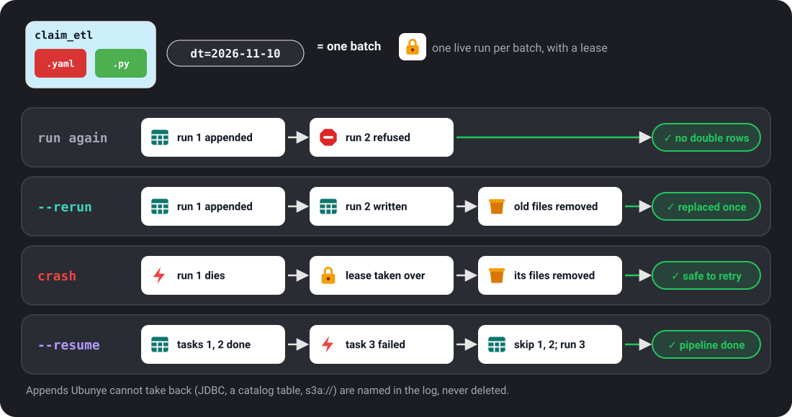

# CLI Reference

Every `ubunye` command and flag, in the order you meet them: start a task, check
it, run it, see what ran, then deploy. Every command also takes `--help`.

## Everyday tasks

| I want to | Command |
|---|---|
| Start a new task | [`ubunye init -d pipelines -u demo -p starter -t filter_adults`](#ubunye-init) |
| Check it before running | [`ubunye validate ...`](#ubunye-validate), [`ubunye plan ...`](#ubunye-plan), [`ubunye doctor`](#ubunye-doctor) |
| Run it | [`ubunye run ... --lineage`](#ubunye-run) |
| See what ran | [`ubunye lineage list ...`](#lineage-list), [`ubunye lineage show ...`](#lineage-show) |
| Compare two runs | [`ubunye lineage compare ...`](#lineage-compare), [`ubunye gate ...`](#ubunye-gate) in CI |
| Deploy it | [`ubunye deploy databricks ...`](#deploy-databricks), [`glue`](#deploy-glue), [`dataproc`](#deploy-dataproc), [`k8s`](#deploy-k8s) |
| Hand it to a scheduler | [`ubunye export airflow ...`](#export-airflow), [`export databricks`](#export-databricks) |

---

## All commands

| Command | What it does |
|---|---|
| [`init`](#ubunye-init) | Scaffold a task, or a CI workflow ([`init github-actions`](#init-github-actions)) |
| [`validate`](#ubunye-validate) | Check config files without running |
| [`config`](#ubunye-config) | Load each task's config and print `[OK]` or the error |
| [`plan`](#ubunye-plan) | Dry run: what each task will read and write, and what will stop it |
| [`doctor`](#ubunye-doctor) | Check this machine, and optionally tasks, before a run |
| [`backends`](#ubunye-backends) | List the execution backends and what each can do |
| [`run`](#ubunye-run) | Run one or more tasks |
| [`test run`](#ubunye-test-run) | Run tasks with a test profile and report PASS/FAIL |
| [`lineage`](#ubunye-lineage) | Read run records: show, list, compare, search, trace, openlineage, focus |
| [`gate`](#ubunye-gate) | Fail a pull request when a run record regresses ([Gate](patterns/gate.md)) |
| [`runs`](#ubunye-runs) | Job health and upstream checks from run records; exit 1 when the answer is no ([Job health](patterns/job-health.md)) |
| [`sync`](#ubunye-sync) | Replay fallback manifests into the configured stores |
| [`deploy`](#ubunye-deploy) | Run or deploy tasks on Databricks, Glue, Dataproc, Kubernetes, Container Apps, EMR Serverless |
| [`export`](#ubunye-export) | Export a task to an orchestrator: Airflow DAG, Databricks job, Spark pipeline |
| [`models`](#ubunye-models) | Manage model versions and their lifecycle |
| [`prove`](#ubunye-prove) | The proving ground: compare one workload's run records across environments |
| [`mcp`](#ubunye-mcp) | Serve the engine to agents over MCP ([Agents over MCP](patterns/mcp.md)) |
| [`plugins`](#ubunye-plugins) | List the discovered reader, writer and transform plugins |
| [`version`](#ubunye-version) | Print the engine version |

---

## Common flags

Most commands that act on a task share these flags. Where a section below says
"common flags", these are the ones it means, with the same meaning.

| Flag | Short | Description |
|---|---|---|
| `--usecase-dir` | `-d` | The pipelines folder (the top folder holding your use cases) |
| `--usecase` | `-u` | Use case name |
| `--pipeline` | `-p` | Pipeline name (`--package` is its old name; it still works with a warning until 1.0) |
| `--task-list` | `-t` | Task name, repeatable (`lineage`, `gate`, `deploy` and `prove` take one `--task` instead) |
| `--data-timestamp` | `-dt` | Data timestamp, injected as `{{ dt }}` in Jinja |
| `--data-timestamp-format` | `-dtf` | Timestamp format, injected as `{{ dtf }}` |
| `--mode` | `-m` | The profile to use (an entry under `ENGINE.profiles`). It must match a profile name exactly, case included. A config with no profiles accepts any mode. `run` defaults to `DEV`; `deploy` uses `PROD`; `export airflow` and `export databricks` use `prod`. See [Profiles](config/engine.md) |
| `--var` | | Extra template variable, `key=value`, repeatable (`run`, `validate`, `plan`, `config`, `doctor`, `test run`, `runs wait-for`, `export spark-pipeline`, `deploy`). See [Jinja](config/jinja.md#cli-injected-variables) |
| `--json` | | Print one JSON document for scripts and agents. See [Machine output](#machine-output-json) |

`run`, `test run` (`--profile`), `config`, `validate`, `plan` and `doctor` check
`-m` one way: a name the config does not define is refused, and a config with no
profiles accepts any name. They default to `DEV` (`test run` to `test`).

!!! warning "Upper or lower case"
    The examples use `DEV` and `PROD`. `export airflow` and `export databricks`
    put `-m prod` in the job by default, which a config with `DEV` and `PROD`
    profiles refuses. Pass `--profile PROD` to match.

---

## Machine output: `--json`

For a script, a CI step or an AI agent, `--json` makes a command print exactly
one JSON document on stdout and nothing else. Errors are JSON too
(`{"ok": false, "error": "..."}`), and the exit code is unchanged, so a caller
can check either.

```bash
ubunye plan -d pipelines -u sales -p etl -t daily --json | jq '.ok'
ubunye validate -d pipelines -u sales -p etl --all --backend pandas --json
ubunye lineage compare -d pipelines -u sales -p etl -t daily --run-id1 A --run-id2 B --json
```

| Command | JSON shape |
|---|---|
| `plan` | `{"ok": bool, "tasks": [plan, ...]}`: each plan has `inputs`, `transform`, `outputs`, `problems`, `warnings`, `config_hash` |
| `validate` | `{"ok": bool, "tasks": [{"task", "ok", "problems"}]}` |
| `backends` | `[{"name", "default", "loaded", "capabilities"}]` |
| `doctor` | `{"ok": bool, "checks": [{"name", "status", "detail", "fix"}]}` |
| `gate` | `{"ok": bool, "task", "baseline", "candidate", "findings": [{"rule", "status", "detail", "output"}]}` |
| `lineage list`, `lineage search` | `[run record, ...]` (an empty list when there are none) |
| `lineage show` | one run record |
| `lineage compare` | per field `{"a", "b", "changed"}`; per output `data_hash.state` is `unchanged`, `changed`, `unknown` or `not comparable` |
| `lineage trace` | `{"task", "run_id", "status", "inputs", "transform", "outputs"}` |
| `runs health` | `{"ok": bool, "tasks": [{"task", "state", "healthy", "last_run_id", "last_status", "last_success_at", "consecutive_failures", "stuck_runs", "problems", ...}]}` |
| `runs wait-for` | `{"ok": true, "task", "run_id", "ended_at", "variables"}`, or `{"ok": false, "error"}` |
| `models list` | model versions, with `stage` as text |
| `models compare` | `{metric: {"a", "b", "delta"}}` |

`models info` always prints the version as JSON, so it has no `--json` flag.

---

## `ubunye init`

Scaffold a task folder that runs straight away.

```bash
ubunye init -d pipelines -u demo -p starter -t filter_adults
```

Creates:

```
pipelines/demo/starter/filter_adults/
    config.yaml            reads data/people.csv, writes output/adults as Parquet
    transformations.py     keeps people aged 18 and over
    data/people.csv        a small sample to start from
    notebooks/
        filter_adults_dev.ipynb
```

and prints what to run next. The transform, `people[people["age"] >= 18]`, means
the same thing in pandas and in Spark, so the task runs with no Java
(`--backend pandas`) and on Spark unchanged. Its paths use `{{ task_dir }}` (the
task's own folder), so it runs from any folder.

`--template databricks` writes the older scaffold instead: read a Unity Catalog
table, write to an `s3a://` bucket. `ubunye init pipeline ...` is the same
command with a subcommand name.

`ubunye init` with no flags prints its help and subcommands and exits 0. Give one
of `-d -u -p -t` and you must give all four.

| Flag | Short | Required | Default | Description |
|---|---|---|---|---|
| `-d -u -p -t` | | yes, to scaffold | | [Common flags](#common-flags); `-t` names the task(s) to scaffold |
| `--template` | | no | `local` | `local` or `databricks` |
| `--overwrite / --no-overwrite` | | no | `no-overwrite` | Overwrite existing files |

!!! note "Changed in 0.7.0"
    `ubunye init -d ...` now works as written (it needed `ubunye init pipeline`),
    and the default scaffold is the local one above.

### `init github-actions`

Write a GitHub Actions workflow that validates the config and runs tests on pull
requests, then deploys to Databricks on merge to `main`. A manual run of the workflow
(`run_after_deploy`) deploys and starts the job. It needs only the `DATABRICKS_HOST`
and `DATABRICKS_TOKEN` secrets: with no `targets.yaml` the deploy uses `DATABRICKS_HOST`.

```bash
ubunye init github-actions -d pipelines -u fraud -p ingestion -t claim_etl
ubunye init github-actions -d pipelines -u fraud -p ingestion -t claim_etl --no-deploy
ubunye init github-actions -d pipelines -u fraud -p ingestion -t task_a -t task_b --extras ml,dev
```

Common flags `-d -u -p -t` are required (`-t`: the tasks to include in the deploy steps).

| Flag | Short | Default | Description |
|---|---|---|---|
| `--extras` | | `spark,dev` | pip install extras, comma-separated |
| `--target` | | `nonprod` | Databricks deploy target |
| `--no-deploy` | | false | Leave out the Databricks deploy steps (CI only) |
| `--output` | `-o` | `.github/workflows/<usecase>_<pipeline>.yml` | Output file |
| `--overwrite` | | false | Overwrite an existing workflow file |

---

## `ubunye validate`

Render Jinja and validate the config schema, before Spark starts. Exits `0` on
success and non-zero if any task fails.

```bash
ubunye validate -d pipelines -u fraud_detection -p ingestion -t claim_etl -dt 2024-06-01
ubunye validate -d pipelines -u fraud_detection -p ingestion --all         # every task
ubunye validate -d pipelines -u fraud_detection -p ingestion -t claim_etl -m DEV
ubunye validate -d pipelines -u fraud_detection -p ingestion -t claim_etl --backend pandas
```

Common flags: `-d -u -p` (required), `-t`, `-dt`, `-dtf`, `--var`, `--json`.

| Flag | Short | Default | Description |
|---|---|---|---|
| `--all` | | false | Validate every task in the pipeline (instead of `-t`) |
| `--profile` | | | Profile to check (`DEV`, `PROD`, ...) |
| `--mode` | `-m` | | The same as `--profile`, the word `run` uses. Giving both with different values is an error. Unlike `run`, a config with no profiles fails when either is given (see [Common flags](#common-flags)) |
| `--backend` | | | Also check every input and output against what this backend can do, without starting it |

---

## `ubunye config`

Load each task's config (Jinja rendered, Pydantic validated) and check the
profile for `-m`. Prints `[OK] Config valid: <path>` per task, or the error
and exit code `1`. A config with no profiles accepts any `-m`.

```bash
ubunye config -d pipelines -u fraud_detection -p ingestion -t claim_etl -dt 2024-06-01
```

Common flags: `-d -u -p -t` (required), `-dt`, `-dtf`, `-m` (default `DEV`), `--var`.

---

## `ubunye plan`

A dry run: what each task will read and write, and what will stop it. It starts
no engine and moves no data, and exits `1` if it finds a problem.

```bash
ubunye plan -d pipelines -u titanic -p pipeline -t clean_data -t aggregate --backend pandas
```

```text
Task titanic/pipeline/clean_data   (backend: pandas)
  Inputs
    titanic      s3 csv         file:///.../data/titanic.csv
                 found: 1 file(s), 60,302 bytes
  Transform  CleanData  (transformations.py)
  Outputs
    cleaned      s3 parquet     file:///.../output/cleaned/dt=latest
                 mode overwrite

Task titanic/pipeline/aggregate   (backend: pandas)
  Inputs
    cleaned      s3 parquet     file:///.../output/cleaned/dt=latest
                 written by task 'clean_data' earlier in this plan
  ...
Plan OK: 2 task(s) can run.
```

It checks:

- each local input exists, or is written by an earlier task in the same plan
  (list the tasks in the order they run);
- the transform class loads from `transformations.py`;
- every write mode resolves (`merge` without `merge_keys` is caught here, not
  on a cluster after the transform ran);
- with `--backend`, that the backend can do what each input and output needs;
- which environment variables the config uses but are not set (a warning).

It checks `-m` against the profiles the way `run` does.

Common flags: `-d -u -p -t` (required; `-t` in run order), `-dt`, `-dtf`, `-m`
(default `DEV`), `--var`, `--json`. Plus:

| Flag | Default | Description |
|---|---|---|
| `--backend` | | Also check against what this backend can do |

!!! note "Changed in 0.7.0"
    `plan` used to print the config's names back and always exit `0`. It now
    checks the task and exits `1` when something would stop the run, so it can
    guard a CI job or an agent before a real run.

---

## `ubunye doctor`

Check this machine before a run: what is installed, what will fail, and why.

```bash
ubunye doctor
ubunye doctor -d pipelines -u fraud -p ingestion -t claims   # also check a task
ubunye doctor --json
```

It checks:

- the Python version (tested: 3.10 to 3.13) and the engine version;
- every backend: usable here, or what it needs and the command to install it;
  and whether a run without `--backend` would work;
- for Spark: that Java is found and suits the installed Spark (see
  [Install](getting_started/install.md) for which Java goes with which Spark),
  that `delta-spark` is built for the same Spark major, and on Windows that
  `HADOOP_HOME` points at `winutils.exe`;
- that every reader, writer, transform and hook plugin loads;
- for each task named with `-t`: the `{{ env.X }}` variables it uses without a
  default that are not set, and whether its config loads and validates.

Common flags, all optional: `-d` (also check tasks under this pipelines folder),
`-u`, `-p`, `-t`, `-dt`, `-m` (default `DEV`, checked as `run` checks it),
`--var`, `--json`.

Each line is `[OK]`, `[WARN]` or `[FAIL]`, with a fix under anything that is not
OK. A warning is about the environment and matters only for what you use (Spark
without Java is fine if you run on pandas). A failure means a run would fail: no
backend can run here, or a named task's config cannot load. Any failure makes
the exit code 1, so `ubunye doctor` can gate a script or a CI step.

```text
[OK] python: Python 3.13.6 on win32
[OK] backend: pandas: usable, single machine
[WARN] backend: spark (default): needs pyspark
       fix: pip install 'ubunye-engine[spark]'
[WARN] default backend: a run without --backend uses 'spark', which cannot run here
       fix: Pass --backend pandas, or install what 'spark' needs.
[FAIL] task claims: environment: not set, and used without a default: CLAIMS_ROOT
       fix: Set them, or give each a default: {{ env.NAME | default('value') }}.
```

---

## `ubunye backends`

List the execution backends that are installed and what each can do: its
features, file formats, write modes, and whether it is distributed or needs
Java. The default is marked.

```bash
ubunye backends
ubunye backends --json
```

A backend that is registered but cannot load (a missing dependency) is listed
with the reason. See [Execution backends](backends.md).

---

## `ubunye run`

Run one or more tasks in order: read inputs, transform, write outputs.

```bash
ubunye run -d pipelines -u fraud_detection -p ingestion -t claim_etl \
    -m PROD --lineage -dt 2024-06-01
```

Common flags: `-d -u -p` (required), `-t` (or `--all`), `-dt`, `-dtf`, `-m`
(default `DEV`), `--var`. `run` picks the profile with `-m` only (it has no
`--profile`). Plus:

| Flag | Default | Description |
|---|---|---|
| `--all` | false | Run every task in the pipeline (instead of `-t`) |
| `--backend` | platform, else `spark` | Execution backend by name, e.g. `pandas` for a run with no Java. See [Execution backends](backends.md) |
| `--lineage` | false | Write a run record for this run ([Run records](guides/run-records.md)) |
| `--lineage-dir` | `.ubunye/lineage` | Where run records go: a directory under `-d` for the filesystem store, as given for any other |
| `--lineage-backend` | `$UBUNYE_LINEAGE_BACKEND`, else `filesystem` | Which store: `filesystem`, `delta` or an installed plugin. See [Where run records are stored](#where-run-records-are-stored) |
| `--rerun` | false | Replace a batch (same `-dt` and `--var`) that a finished run already appended |
| `--resume` | false | Skip tasks that already finished this batch, run the rest |
| `--deploy-mode` | `client` | Spark deploy mode (`cluster` or `client`) |



!!! note "Running a batch again"
    A batch is a task with its `-dt` and `--var` values. Running a finished batch
    of a task that appends is refused, so the data does not land twice: pass
    `--rerun` to replace it, or `--resume` to finish a pipeline that stopped half
    way. What each kind of output does: [Safe reruns](guides/safe-reruns.md).

---

## `ubunye test run`

Run one or more tasks with a test profile and report PASS/FAIL per task.
Config is validated before Spark starts; invalid configs are reported as `[CONFIG FAIL]`
and the command exits non-zero at once.

```bash
ubunye test run -d pipelines -u fraud_detection -p ingestion -t claim_etl
```

Common flags: `-d -u -p -t` (required), `-dt`, `--var`. Plus:

| Flag | Default | Description |
|---|---|---|
| `--profile` | `test` | Profile to use. Checked as `run` checks `-m` |
| `--lineage / --no-lineage` | `lineage` | Write a run record (on by default) |
| `--lineage-dir` | `.ubunye/lineage` | As for `run` |
| `--lineage-backend` | `$UBUNYE_LINEAGE_BACKEND`, else `filesystem` | As for `run` |
| `--backend` | platform, else `spark` | Execution backend by name, e.g. `pandas` to test with no Java |

---

## `ubunye lineage`

Read the run records written by `ubunye run --lineage` (and by `ubunye test run`,
which writes them by default). A run record says what one run read, wrote and
ran with; [Run records](guides/run-records.md) shows how to use them.

!!! note
    Lineage subcommands use `--task` (`-t`, one task), not `--task-list`. All of
    them take `-d -u -p -t` (required), `--lineage-dir` (default
    `.ubunye/lineage`, under `-d`) and `--lineage-backend`.

### Where run records are stored

Run records go to a store, chosen by name, in this order:
`--lineage-backend` (or `lineage_backend=` in the Python API), then the
`UBUNYE_LINEAGE_BACKEND` environment variable, then `filesystem`.

| Store | `--lineage-dir` is | Needs |
|---|---|---|
| `filesystem` (default) | a directory under `--usecase-dir`: `<usecase_dir>/.ubunye/lineage/<usecase>/<pipeline>/<task>/<run_id>.json` | nothing |
| `delta` | a Delta table name (`main.ops.ubunye_runs`) or path (`s3://bucket/ubunye/runs`), used as given | `pip install 'ubunye-engine[delta]'`, a SparkSession with Delta (the active one, or a local one it starts and tunes for its small table) |
| a plugin | whatever that store takes, as given | its package, registered in `ubunye.lineage_backends` |

Jobs that share no disk can share a table:

```bash
export UBUNYE_LINEAGE_BACKEND=delta
ubunye run -d pipelines -u shop -p orders -t clean --lineage --lineage-dir main.ops.ubunye_runs
ubunye lineage list -d pipelines -u shop -p orders -t clean --lineage-dir main.ops.ubunye_runs
```

The Delta store keeps the whole record as JSON, plus columns to query it by
(`run_id`, `task_path`, `usecase`, `package`, `task`, `status`, `started_at`,
`ended_at`, `variables`, `record_version`, `written_at`). It only appends; the
row written last for a run is the run. If a record cannot be written (no Spark,
no Delta, no access), it is kept in `~/.ubunye/fallback/<run_id>/lineage.jsonl`
with a warning, and
`ubunye sync lineage --lineage-backend delta --lineage-dir <table>` replays it. A store of your own passes
`ubunye.testing.lineage_conformance` (see [Interfaces](interfaces.md)).

Why it works this way: [ADR 011](architecture/adr-011-run-record-stores.md).

### `lineage show`

Show a run record as formatted JSON (the latest, or `--run-id`). Takes `--json`.

```bash
ubunye lineage show -d pipelines -u fraud_detection -p ingestion -t claim_etl
ubunye lineage show -d pipelines -u fraud_detection -p ingestion -t claim_etl --run-id <run_id>
```

Each input also records its source's version (`source_version`), so the record
can say whether the input's data hash is of what the run read
(`source_changed`, `source_note`). What each field means:
[What an input's hash covers](guides/run-records.md#what-an-inputs-hash-covers).

### `lineage list`

List recent runs for a task (newest first). `-n/--n` sets how many (default 10).
Takes `--json`.

```bash
ubunye lineage list -d pipelines -u fraud_detection -p ingestion -t claim_etl
ubunye lineage list -d pipelines -u fraud_detection -p ingestion -t claim_etl -n 20
```

### `lineage compare`

Diff two run records: status, config, code and environment hashes (naming the
packages whose versions changed), and each input's and output's row count,
schema hash and data hash. Takes `--json`.

```bash
ubunye lineage compare -d pipelines -u fraud_detection -p ingestion -t claim_etl \
    --run-id1 <id1> --run-id2 <id2>
```

A data hash is compared only when both runs have one made the same way.
Two missing hashes show as "unknown", and a record from before 0.7.0 (which
hashed a sample) shows as "not comparable" with a newer one. See
[Run records](guides/run-records.md#compare-two-runs).

### `lineage search`

Search all recorded runs across tasks. Only `-d` is required; `-u`, `-p` and
`-t` narrow the search, `--status` takes `success`, `error` or `running`, and
`--since` takes an ISO date. Takes `--json`.

```bash
ubunye lineage search -d pipelines -t claim_etl
ubunye lineage search -d pipelines --status success --since 2024-06-01
```

### `lineage trace`

Print the input, transform and output data flow graph for a run (latest, or
`--run-id`). Takes `--json`.

```bash
ubunye lineage trace -d pipelines -u fraud_detection -p ingestion -t claim_etl
```

### `lineage openlineage`

Print stored runs as OpenLineage events, one JSON per line (START, then
COMPLETE or FAIL). `--run-id` picks one run (default: every run), `--namespace`
sets the job namespace, and `--send` also sends them where `OPENLINEAGE_URL`
points (a backfill). See [OpenLineage](patterns/openlineage.md).

```bash
ubunye lineage openlineage -d pipelines -u fraud_detection -p ingestion -t claim_etl
```

### `lineage focus`

A run's model calls as FOCUS 1.4 cost rows, for FinOps tools. `--format` is
`csv` (default) or `jsonl`; `-o/--output` writes a file instead of stdout;
`--run-id` picks a run (default: latest).

```bash
ubunye lineage focus -d pipelines -u fraud_detection -p ingestion -t claim_etl -o cost.csv
```

---

## `ubunye gate`

Compare a run's record with a baseline and exit `1` if it regresses. See
[Gate](patterns/gate.md).

```bash
# two run records saved with `ubunye lineage show --json`
ubunye gate --baseline base.json --candidate head.json

# from the run record store: by run id, or latest / previous
ubunye gate -d pipelines -u shop -p orders -t clean                # previous vs latest
ubunye gate -d pipelines -u shop -p orders -t clean --baseline 1a2b3c4d
```

Common flags `-d -u -p` and `--task/-t` (one task) find the records in the store;
`--lineage-dir` and `--lineage-backend` as for `lineage`; `--json`. Plus:

| Flag | Default | Description |
|---|---|---|
| `--baseline` | `previous` | A run record file, a run id, or `previous` |
| `--candidate` | `latest` | A run record file, a run id, or `latest` |
| `--allow-data-change` | false | A changed output warns instead of failing |
| `--max-slowdown` | | Fail when slower than the baseline by more than this (`0.5` = 50%) |
| `--max-seconds` | | Fail when the candidate took longer than this |
| `--max-row-change` | | Fail when an output's row count moved by more than this (`0.1` = 10%) |
| `--require-replay` | false | Fail if any model call went live instead of replaying (`UBUNYE_LLM_MODE=replay`) |
| `--max-llm-cost-increase` | | Fail if the model bill grew by more than this share, e.g. `0.2` |
| `--summary` | | Append a Markdown table to this file (`$GITHUB_STEP_SUMMARY`) |

---

## `ubunye runs`

Questions a scheduler asks, answered from run records in the chosen store
(`--lineage-backend`, `--lineage-dir`, as for `lineage`). Both exit 1 when the
answer is no, and both take `--json`. See
[Job health and upstream checks](patterns/job-health.md) and
[ADR 013](architecture/adr-013-receipt-queries.md).

### `runs health`

```bash
ubunye runs health -d pipelines -u pay [-p monthly] [--max-age 36h] [--stuck-after 6h] [--json]
ubunye runs health -d pipelines --task pay/monthly/calc --task pay/monthly/send
```

Per task: state (`ok`, `running`, `failing`, `stuck`, `stale`, `never_run`), last
status, when it last succeeded, runs in a row that failed, and runs still
`running` after `--stuck-after` (default `6h`; likely dead). Exit 1 when any task
is failing, stuck, or older than `--max-age`. `-d` is required; `-u`, `-p` and
`--task usecase/pipeline/task` (repeatable) pick the tasks.

### `runs wait-for`

```bash
ubunye runs wait-for pay/monthly/calc -d pipelines --var month=2026-10 [--timeout 2h] [--poll 60s] [--json]
```

Exit 0 once the task has a successful run for this batch (`-dt` and every
`--var` match), 1 otherwise. `--timeout` (default 0, look once) waits, looking
again every `--poll` (default `60s`). A task can ask the same in its config with
`CONFIG.requires`.

---

## `ubunye sync`

Replay fallback manifests into the configured stores. When a run record or a
model registry write fails during a run, the record is kept in a local file
under `~/.ubunye/fallback/` so the run does not fail. This command replays
them, skipping records already written, and moves each processed manifest to
`~/.ubunye/fallback/synced/`. How it works: [Interfaces](interfaces.md#fallback-manifests-and-ubunye-sync).

```bash
ubunye sync lineage                    # replay all run record manifests
ubunye sync lineage --run-id abc123    # replay one run
ubunye sync lineage --lineage-backend delta --lineage-dir main.ops.ubunye_runs
ubunye sync registry                   # replay all registry manifests
ubunye sync registry --run-id abc123
```

| Flag | Applies to | Default | Description |
|---|---|---|---|
| `--run-id` | both | | Replay only this run's manifest |
| `--lineage-backend` | `sync lineage` | `$UBUNYE_LINEAGE_BACKEND`, else `filesystem` | The run record store to replay into |
| `--lineage-dir` | `sync lineage` | `.ubunye/lineage` | The store's location, as given |

---

## `ubunye deploy`

Deploy or run a task on a remote platform. Each platform has a guide under
[Deployment](deployment.md). These commands take `--task/-t` (repeat it to run
several tasks in order, except on Databricks) and `-m` defaults to `PROD`.

A problem you can fix (no `targets.yaml`, no token, a cloud CLI not on `PATH`, a
config that does not validate) ends in one `[ERROR]` message that says what, where
and what to try, with exit code 1. `ubunye export` works the same way.

### `deploy databricks`

Deploy a task to Databricks as a scheduled job.

```bash
ubunye deploy databricks -d pipelines -u fraud_detection -p ingestion -t claim_etl --target nonprod
ubunye deploy databricks -d pipelines -u fraud_detection -p ingestion -t claim_etl --target nonprod --dry-run
```

Common flags: `-d -u -p` and `-t` (one task), all required; `-m` (default
`PROD`); `-dt`. Plus:

| Flag | Default | Description |
|---|---|---|
| `--target` | `dev` | Deploy target from `targets.yaml` |
| `--dry-run` | false | Print the job spec without deploying |
| `--host` | | Databricks host for an ad hoc deploy (skips `targets.yaml`) |
| `--token` | `DATABRICKS_TOKEN` | Name of the env var that holds the token |

`targets.yaml` is read from `<usecase-dir>/<usecase>/targets.yaml`, and a
`targets.yaml` in the task folder overrides it. See
[Databricks authentication](databricks-auth.md).

### `deploy glue`

Run a task on AWS Glue 5 (Spark 3.5), with the `aws` CLI. See [One command to the cloud](deployment/serverless.md).

```bash
ubunye deploy glue -d pipelines -u shop -p orders -t clean \
    --bucket my-bucket --role arn:aws:iam::123456789012:role/glue-job --dry-run
```

Common flags `-d -u -p -t` (required), plus the [shared launch flags](#shared-launch-flags) and:

| Flag | Required | Default | Description |
|---|---|---|---|
| `--bucket` | yes | | S3 bucket for the task, script and wheel |
| `--role` | yes | | IAM role ARN the Glue job runs as |
| `--region` | no | | AWS region |
| `--job` | no | from the task | Glue job name |
| `--engine` | no | `ubunye-engine` | pip requirement for the engine |
| `--engine-wheel` | no | | Install this wheel instead |
| `--workers` | no | `2` | Number of workers |
| `--worker-type` | no | `G.1X` | Glue worker type |

### `deploy dataproc`

Run a task on GCP Dataproc Serverless, in a container image, with `gcloud`. See
[One command to the cloud](deployment/serverless.md).

Common flags `-d -u -p -t` (required), plus the [shared launch flags](#shared-launch-flags) and:

| Flag | Required | Default | Description |
|---|---|---|---|
| `--project` | yes | | GCP project |
| `--region` | yes | | GCP region |
| `--bucket` | yes | | GCS bucket for the task and script |
| `--image` | yes | | Container image with the engine (see `deploy dockerfile dataproc`) |
| `--service-account` | no | | Service account the batch runs as |
| `--runtime` | no | `2.2` | Dataproc Serverless runtime version |
| `--batch` | no | from the task | Batch id |

### `deploy k8s`

Run a task as a Kubernetes Job, with `kubectl` (its current context). The image
comes from `deploy dockerfile container`, with the pipelines baked in, so there
is no `-d`. See [One command to the cloud](deployment/serverless.md).

Common flags `-u -p -t` (required), plus the [shared launch flags](#shared-launch-flags) and:

| Flag | Short | Required | Default | Description |
|---|---|---|---|---|
| `--image` | | yes | | Image from `deploy dockerfile container` |
| `--namespace` | `-n` | no | `default` | Kubernetes namespace |
| `--job` | | no | from the task | Job name |
| `--cpu` | | no | `1` | CPU request |
| `--memory` | | no | `2Gi` | Memory request |
| `--timeout` | | no | `1800` | Seconds to wait for the job |

### `deploy container-apps`

Run a task as an Azure Container Apps job, with the `az` CLI. Like `k8s`, the
image holds the pipelines. See [One command to the cloud](deployment/serverless.md).

Common flags `-u -p -t` (required), plus the [shared launch flags](#shared-launch-flags) and:

| Flag | Short | Required | Default | Description |
|---|---|---|---|---|
| `--image` | | yes | | Image from `deploy dockerfile container` |
| `--resource-group` | `-g` | yes | | Azure resource group |
| `--environment` | | yes | | Container Apps environment |
| `--job` | | no | from the task | Job name |
| `--registry-server` | | no | | Registry server |
| `--registry-identity` | | no | | Managed identity (resource id) that pulls the image |
| `--cpu` | | no | `2` | CPU |
| `--memory` | | no | `4Gi` | Memory |
| `--timeout` | | no | `1800` | Seconds a replica may run |

### `deploy emr-serverless`

Start a task run on AWS EMR Serverless, with the `aws` CLI. It does not wait for
the run to finish, so it has no `--wait` or `--record-out`. See
[One command to the cloud](deployment/serverless.md).

Common flags `-u -p -t` (required), `-m` (default `PROD`), `-dt`, `--var`. Plus:

| Flag | Required | Default | Description |
|---|---|---|---|
| `--application-id` | yes | | An application whose image is from `deploy dockerfile emr-serverless` |
| `--role` | yes | | Job execution role ARN |
| `--bucket` | yes | | S3 bucket for the job's logs |
| `--region` | no | | AWS region |
| `--env` | no | | Environment for the task, `KEY=VALUE` (repeatable) |
| `--dry-run` | no | false | Print the plan; run nothing |

### Shared launch flags

`glue`, `dataproc`, `k8s` and `container-apps` also take:

| Flag | Short | Default | Description |
|---|---|---|---|
| `--mode` | `-m` | `PROD` | Profile |
| `--data-timestamp` | `-dt` | | Data timestamp |
| `--env` | | | Environment for the task, `KEY=VALUE` (repeatable) |
| `--var` | | | Template variable, `KEY=VALUE` (repeatable) |
| `--wait / --no-wait` | | `wait` | Follow the run to its end |
| `--record-out` | | | Save the run's record here (for `ubunye gate`); with several tasks, one file each: `NAME.TASK.json` |
| `--dry-run` | | false | Print the plan; run nothing |

### `deploy dockerfile`

Write a Dockerfile for a Spark job image on `PLATFORM` (`dataproc`,
`emr-serverless` or `container`), and the entry script next to it.

```bash
ubunye deploy dockerfile container --pipelines pipelines --out build/Dockerfile
```

| Flag | Default | Description |
|---|---|---|
| `--pipelines` | `pipelines` | Folder copied into the image as `/app/pipelines` |
| `--engine` | `ubunye-engine` | pip requirement for the engine |
| `--out` | | Write here instead of printing. A folder, or a path ending in `/` such as `img/`, gets `<folder>/Dockerfile`; missing folders are made |

---

## `ubunye export`

Generate orchestration artifacts from a task's `config.yaml`. Defaults come from
the config's `ORCHESTRATION` block (see [Orchestration](config/orchestration.md)).

`ubunye export` defaults to production (`--profile prod` for `airflow` and
`databricks`, `-m PROD` for `spark-pipeline`), while `ubunye run` defaults to `DEV`:
an export is what a scheduler runs, a run is usually a try on your own machine.
Pass the profile you mean when it matters.

### `export airflow`

Generate an Airflow DAG (Airflow 2.4+ and 3) that runs the task with the CLI.

```bash
ubunye export airflow \
    -c pipelines/fraud_detection/ingestion/claim_etl/config.yaml \
    -o dags/claim_etl.py
```

| Flag | Short | Required | Default | Description |
|---|---|---|---|---|
| `--config` | `-c` | yes | | Path to the task's `config.yaml` |
| `--output` | `-o` | yes | | Where to write the DAG |
| `--profile` | | no | `prod` | Profile put in the bash command as `-m`. Lower case by default, while `ubunye run` defaults to `DEV`: pass `--profile PROD` if your profiles are upper case |
| `--usecase-dir` | | no | this folder | The pipelines folder where Airflow runs |
| `--backend` | | no | | Backend for the run |
| `--lineage` | | no | false | Write a run record for each run |

### `export databricks`

Generate a Databricks Jobs API spec (`job.json`) for the task.

```bash
ubunye export databricks \
    -c pipelines/fraud_detection/ingestion/claim_etl/config.yaml \
    -o jobs/claim_etl.json
```

| Flag | Short | Required | Default | Description |
|---|---|---|---|---|
| `--config` | `-c` | yes | | Path to the task's `config.yaml` |
| `--output` | `-o` | yes | | Where to write `job.json` |
| `--profile` | | no | `prod` | Profile put in the job command as `-m`. Lower case by default, as for `export airflow` |

### `export spark-pipeline`

Write the task as a Spark Declarative Pipeline (Spark 4.1+), to run with
`spark-pipelines`.

```bash
ubunye export spark-pipeline \
    -c pipelines/fraud_detection/ingestion/claim_etl/config.yaml \
    -o sdp/claim_etl
```

Common flags: `-m` (default `PROD`), `-dt`, `--var`. Plus:

| Flag | Short | Required | Default | Description |
|---|---|---|---|---|
| `--config` | `-c` | yes | | Path to the task's `config.yaml` |
| `--output` | `-o` | yes | | Folder to write the pipeline into |
| `--storage` | | no | a folder inside the output | Pipeline storage URI |
| `--name` | | no | | Pipeline name |
| `--catalog` | | no | | Catalog |
| `--database` | | no | | Database |

---

## `ubunye models`

Manage ML model versions and their lifecycle.

Every subcommand takes:

| Flag | Short | Required | Description |
|---|---|---|---|
| `--use-case` | `-u` | yes | Use case grouping (note the hyphen: other commands say `--usecase`) |
| `--model` | `-m` | yes | Model name (here `-m` is not the profile) |
| `--store` | `-s` | yes | Model store path |
| `--backend` | `-b` | no | Registry backend: an entry point in `ubunye.registry_backends` (`filesystem`, `mlflow`, a plugin). Default `UBUNYE_REGISTRY_BACKEND`, else `filesystem`. See [Interfaces](interfaces.md#registrybackend) |

`info`, `promote`, `demote`, `rollback` and `archive` also require `--version` (`-v`).
`list` and `compare` take `--json`.

### `models list`

```bash
ubunye models list -u fraud_detection -m FraudRiskModel -s .ubunye/model_store
```

### `models info`

```bash
ubunye models info -u fraud_detection -m FraudRiskModel -v 1.3.0 -s .ubunye/model_store
```

### `models promote`

```bash
ubunye models promote -u fraud_detection -m FraudRiskModel -v 1.3.0 \
    --to production --promoted-by alice -s .ubunye/model_store
```

Target stages: `staging`, `production`.

The version must pass the model's promotion gates first: the `promotion_gates`
its training run registered it with (for example `min_auc: 0.85`). If one fails,
nothing is promoted and the failing gate is named. `--force` promotes anyway,
prints which gates were skipped, and marks the version (`promotion_forced`) so
the skip stays on the record. See [Model registry](ml/registry.md).

### `models demote`

```bash
ubunye models demote -u fraud_detection -m FraudRiskModel -v 1.3.0 \
    --to staging -s .ubunye/model_store
```

Target stages: `development`, `staging`, `archived`.

Demote only moves a version down. `staging` is allowed only from `production`;
`production` is never a choice. To move a version up, use `models promote`,
which checks the promotion gates.

### `models rollback`

```bash
ubunye models rollback -u fraud_detection -m FraudRiskModel -v 1.2.0 -s .ubunye/model_store
```

Archives the current production version and restores `--version` to production.

### `models archive`

```bash
ubunye models archive -u fraud_detection -m FraudRiskModel -v 1.1.0 -s .ubunye/model_store
```

### `models compare`

```bash
ubunye models compare -u fraud_detection -m FraudRiskModel \
    --versions 1.2.0 --versions 1.3.0 -s .ubunye/model_store
```

---

## `ubunye prove`

The proving ground: run one workload on many environments, turn each run record
into an observation, and compare them. See [Proving ground](proving-ground/index.md).

```bash
ubunye prove observe --workload c01 --env pandas-local -d . -u uc -p pkg -t task -o evidence
ubunye prove observe --workload c01 --env aws-glue --record glue.json -o evidence
ubunye prove skip    --workload c01 --env azure --status not_run --reason "..." -o evidence
ubunye prove report  evidence --workload c01 --reference spark-local --expect aws-glue
```

### `prove observe`

Turn a run record into an observation of a workload in an environment. Name the
record with `--record FILE`, or with `-d -u -p -t` and `--run-id` (default
`latest`). Several tasks (`-t a -t b`) give one observation each, named
`<workload>-<task>`.

| Flag | Short | Required | Default | Description |
|---|---|---|---|---|
| `--workload` | | yes | | The workload's id, e.g. `c01-portable-etl` |
| `--env` | | yes | | The environment's name, e.g. `spark-local` |
| `--out` | `-o` | no | `evidence` | The evidence folder |
| `--record` | | no | | A run record JSON file |
| `-d -u -p -t` | | no | | Find the record in the run record store |
| `--run-id` | | no | `latest` | A stored run's id, or `latest` |
| `--kind` | | no | `local` | `local`, `cloud` or `managed` |
| `--provider` | | no | | `aws`, `gcp`, `azure`, `databricks`, ... |
| `--runtime` | | no | | e.g. `Glue 5.0`, `Dataproc Serverless 2.2` |
| `--region` | | no | | Region |
| `--cost-amount` | | no | | Cost of the run |
| `--cost-currency` | | no | `USD` | Currency |
| `--cost-basis` | | no | `local` for `--kind local`, else `unknown` | `actual`, `provider_estimate`, `ubunye_estimate`, `local` or `unknown` |
| `--cost-source` | | no | | How the figure was obtained |
| `--run-url` | | no | | Where a reader can check this run |

### `prove skip`

Record that an environment did not run the workload, and why. Takes
`--workload`, `--env` and `--reason` (all required), `--status` (`not_run`
(default), `unsupported` or `failed_to_launch`), `-o/--out` (default
`evidence`) and `--run-url`.

`--kind`, `--cost-basis` and `--status` take only the values listed. Any other
value is a usage error (exit 2) that lists the choices.

### `prove report`

Compare every observation of a workload in the `EVIDENCE` folder with the
`--reference` environment, and exit `1` if any run disagrees. `--expect` takes a
comma-separated list of environments; one with no evidence is reported as NOT
RUN. `--json FILE` and `--md FILE` write the matrix and the table.

---

## `ubunye mcp`

Serve the engine to agents over MCP (stdio). Its tools: tasks, doctor, plan,
runs, health, upstream, gate, focus, and `run` when allowed. See
[Agents over MCP](patterns/mcp.md).

```bash
ubunye mcp -d pipelines
ubunye mcp -d pipelines --allow-run
```

| Flag | Short | Default | Description |
|---|---|---|---|
| `--usecase-dir` | `-d` | `.` | The pipelines folder the server works in |
| `--allow-run` | | false | Offer the `run` tool (every other tool only reads) |
| `--allow-live-llm` | | false | Let `run` call models live (default: replay, no key, no spend) |
| `--lineage-dir` | | `.ubunye/lineage` | As for `lineage` |
| `--lineage-backend` | | `$UBUNYE_LINEAGE_BACKEND`, else `filesystem` | As for `lineage` |

---

## `ubunye plugins`

List the readers, writers and transforms discovered through entry points. See
[Writing a plugin](connectors/plugin_guide.md).

```bash
ubunye plugins
```

---

## `ubunye version`

```bash
ubunye version
# Ubunye Engine v0.9.0
```

The version comes from the installed package metadata.

---

!!! note "`python -m ubunye` is a different, smaller runner"
    `python -m ubunye` is not this CLI. It is a small runner for `spark-submit` on
    platforms with no console script (EMR Serverless, Dataproc Serverless, YARN,
    Kubernetes): it runs one task,
    `python -m ubunye --task-dir <folder with config.yaml> --mode PROD --dt <dt>`,
    attached to the SparkSession spark-submit made. Its only other flags are
    `--lineage` and `--log-level`. See [Deploy anywhere](deployment/anywhere.md).
