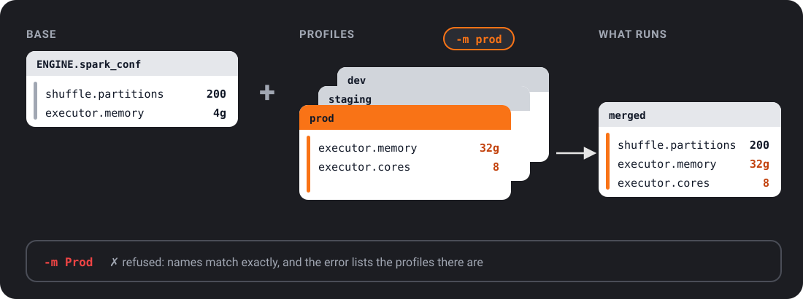

# Engine & Profiles

The `ENGINE` section holds Spark settings, and **profiles**: named sets of overrides
for each environment (DEV, PROD), picked with `-m`. This page is for anyone who runs
one task in more than one place without copying its config.

---

## Structure

```yaml
ENGINE:
  spark_conf:                          # base Spark settings (all profiles)
    spark.sql.shuffle.partitions: "200"
    spark.executor.memory: "4g"

  profiles:
    DEV:                               # overrides applied with -m DEV (the default)
      spark_conf:
        spark.sql.shuffle.partitions: "4"
        spark.executor.memory: "512m"
    STAGING:
      spark_conf:
        spark.executor.memory: "8g"
    PROD:
      spark_conf:
        spark.executor.memory: "32g"
        spark.executor.cores: "8"
```

The memory and cores keys here take effect only when Ubunye starts Spark itself.
See [Spark keys fixed at session start](#spark-keys-fixed-at-session-start).

---

## Fields

### `EngineConfig`

| Field | Type | Default | Description |
|---|---|---|---|
| `spark_conf` | `Dict[str, str]` | `{}` | Base Spark configuration keys applied in all profiles |
| `profiles` | `Dict[str, EngineProfile]` | `{}` | Named profiles that override `spark_conf`, `catalog` and `schema_name` |
| `catalog` | string | `null` | Catalog to switch to before the task runs (`USE CATALOG`) |
| `schema_name` | string | `null` | Schema to switch to before the task runs (`USE SCHEMA`) |

### `EngineProfile`

| Field | Type | Default | Description |
|---|---|---|---|
| `spark_conf` | `Dict[str, str]` | `{}` | Spark conf overrides for this profile |
| `catalog` | string | `null` | Replaces `ENGINE.catalog` for this profile |
| `schema_name` | string | `null` | Replaces `ENGINE.schema_name` for this profile |

`catalog` and `schema_name` apply on a Spark backend only. Open-source Spark has
no `USE CATALOG`; when the switch fails, the engine logs it and carries on, so
fully qualified table names still work.

---

## Profile merge rules



When `-m <name>` (`--mode`) is passed, the engine builds the Spark settings like this:

1. Start with the base `ENGINE.spark_conf` dict.
2. Update with the named profile's `spark_conf` (profile values **win** on conflict).

Profile-only keys are additive; base keys not overridden by the profile are kept.
A profile's `catalog` or `schema_name`, when set, replaces the base value.

---

## Using profiles at runtime

`run` picks a profile with `-m` (`--mode`). `validate` takes `-m` or `--profile`
(the same thing). The name must match a key under `profiles:` exactly, including
its case: `-m prod` does not find a profile named `PROD`.

`-m` defaults to `DEV` (upper case). When a config defines `profiles:` and the
mode names none of them, the run stops with `ConfigProfileError` and lists the
valid names. Name your profiles `DEV` and `PROD` so the default finds one. A config
with no `profiles:` ignores the mode and uses the base `spark_conf`.

```bash
# Development: small cluster, few shuffle partitions (-m DEV is the default)
ubunye run -d pipelines -u fraud -p etl -t claims -m DEV

# Production: full cluster
ubunye run -d pipelines -u fraud -p etl -t claims -m PROD
```

`validate` checks the profile the same way `run` does, and also defaults to `DEV`.
So a config whose profiles are `dev` and `prod` fails `validate` before it can fail
a run:

```text
Profile 'DEV' not found.

  Profile:   DEV
  Available: ['dev', 'prod']
  Hint: This config's profiles are: dev, prod. Names match exactly, case included; did you mean 'dev'? Pass -m dev. With no -m, run, validate, plan and doctor use DEV.
```

Validate with the profile you will run: `ubunye validate ... -m PROD`. `plan` and
`doctor` check it the same way.

---

## Common Spark settings

These keys can be changed on any Spark session, so they work everywhere, Databricks
included:

```yaml
ENGINE:
  spark_conf:
    # Shuffle tuning
    spark.sql.shuffle.partitions: "200"
    spark.sql.adaptive.enabled: "true"
    spark.sql.adaptive.coalescePartitions.enabled: "true"

    # Delta
    spark.databricks.delta.optimizeWrite.enabled: "true"
    spark.databricks.delta.autoCompact.enabled: "true"
```

Memory and Hive keys are fixed when Spark starts; see the next section.

!!! note
    All values must be **strings**: Spark's configuration API accepts only strings.
    Use `"true"` not `true`, `"200"` not `200`.

---

## Spark keys fixed at session start

Some Spark keys are read once, when the Spark session starts, and can never be
changed after. Examples:

- `spark.jars`, `spark.jars.packages` (JDBC drivers, Delta jars)
- `spark.sql.extensions`, `spark.sql.catalogImplementation`,
  `spark.sql.warehouse.dir` (Delta, Hive)
- `spark.driver.*`, `spark.executor.memory`, `spark.executor.memoryOverhead`,
  `spark.executor.cores` (memory and cores)
- `spark.master`

Where such a key works depends on who starts the session:

| Who starts Spark | A fixed key in `ENGINE.spark_conf` |
|---|---|
| Ubunye (`ubunye run` on the `spark` backend, no session running yet) | applied |
| The platform (Databricks, EMR, Dataproc, Glue, `spark-submit`, a notebook) | refused with `SparkSessionError`, naming each key |

Where the platform starts Spark, set these keys there instead: the cluster
settings, a cluster policy, the job's conf, or `spark-submit --conf` / `--jars`.
The engine refuses them rather than ignoring them, so a task never believes it
enabled Delta or chose a cluster when it did not. A config may not set
`spark.master` when the platform already chose one; see
[Deployment](../deployment.md) for that rule.

A setup where Ubunye starts Spark itself, with Hive:

```yaml
ENGINE:
  spark_conf:
    spark.executor.memory: "8g"
    spark.driver.memory: "4g"
    spark.executor.memoryOverhead: "1g"
    spark.sql.catalogImplementation: "hive"
    spark.sql.warehouse.dir: "/user/hive/warehouse"
```

---

## ENGINE is optional

If you omit `ENGINE` entirely the engine uses Spark defaults:

```yaml
MODEL: etl
VERSION: "1.0.0"
CONFIG:
  inputs:
    ...
  outputs:
    ...
```
