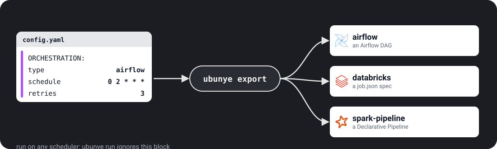

# Orchestration

The `ORCHESTRATION` section says when and how a scheduler should run your task: a
schedule, retries, an owner. This page is for anyone handing a task to Airflow or a
Databricks job. It does **not** affect how `ubunye run` executes the task: it is
used only by `ubunye export airflow` and `ubunye export databricks`.



---

## Structure

```yaml
ORCHESTRATION:
  type: airflow           # required. Implemented today: airflow, databricks
  schedule: "0 2 * * *"  # cron expression
  retries: 3
  owner: data-engineering
  tags:
    - fraud
    - etl
  databricks:             # Databricks job cluster settings
    spark_version: "17.3.x-scala2.13"
    node_type_id: "Standard_DS3_v2"
    num_workers: 4
```

---

## Fields

| Field | Type | Default | Description |
|---|---|---|---|
| `type` | `airflow` or `databricks` | required | Target platform. `prefect` and `dagster` are accepted by the schema but have no exporter yet |
| `schedule` | string | `null` | Cron expression for the DAG/workflow schedule |
| `retries` | int | `2` | Number of automatic retries on failure (Airflow) |
| `owner` | string | `null` | Team or person responsible (shown in Airflow UI) |
| `tags` | list of strings | `[]` | Labels for filtering in the orchestration UI |
| `databricks` | dict | `null` | Databricks job settings, read by `export databricks` |

No other key is allowed: a typo under `ORCHESTRATION` is refused by `ubunye validate`.

When a field is left out, the Airflow DAG uses its own default: schedule
`@daily`, owner `ubunye`, tags `[ubunye]`. With no `ORCHESTRATION` block at all,
`export airflow` still works and uses 1 retry.

The keys `export databricks` reads from `databricks:` are `spark_version`
(default `17.3.x-scala2.13`, Databricks Runtime 17.3 LTS), `node_type_id` (default
`i3.xlarge`), `num_workers` (default 2), `spark_conf`, `aws_attributes`, `job_name`,
`wheel_dbfs_path` (default `dbfs:/libs/ubunye_engine-<installed version>-py3-none-any.whl`)
and `timezone_id` (default `UTC`). Other keys there are ignored.

---

## Which profile an export uses

Each export writes a profile name into the command it generates. The defaults
differ, in name and in case:

| Command | Flag | Default |
|---|---|---|
| `ubunye run` | `-m` | `DEV` |
| `ubunye export airflow` | `--profile` | `prod` (lower case) |
| `ubunye export databricks` | `--profile` | `prod` (lower case) |
| `ubunye export spark-pipeline` | `-m` | `PROD` (upper case) |

A profile name must match a key under `ENGINE.profiles` exactly, case included
(see [Engine & Profiles](engine.md#using-profiles-at-runtime)). So name your
profiles `DEV` and `PROD`, and always pass the profile to `export airflow` and
`export databricks` (`--profile PROD`) rather than relying on its lower-case
default. A config with no `profiles:` ignores the name.

---

## Airflow export

```bash
ubunye export airflow \
    -c pipelines/fraud/etl/claims/config.yaml \
    -o dags/claims_etl.py \
    --profile PROD
```

The generated DAG contains a single `BashOperator` that runs:

```bash
ubunye run -d <pipelines folder> -u fraud -p etl -t claims -m PROD -dt {{ ds }}
```

`--profile` on `export` becomes `-m` in the command (`ubunye run` has no
`--profile`). `{{ ds }}` is Airflow's logical date, so each scheduled run gets its
own `dt`. The pipelines folder is the absolute path of the one the config sits
in; pass `--usecase-dir` when Airflow sees it at another path. `--backend` and
`--lineage` on `export airflow` are added to the command too.

Schedule, retries, owner, and tags are read from `ORCHESTRATION`.

---

## Databricks export

```bash
ubunye export databricks \
    -c pipelines/fraud/etl/claims/config.yaml \
    -o jobs/claims_etl.json \
    --profile PROD
```

The generated JSON can be submitted with the Databricks CLI:

```bash
databricks jobs create --json-file jobs/claims_etl.json
databricks jobs run-now --job-id <ID>
```

Cluster settings from `ORCHESTRATION.databricks` are embedded in the job JSON.
The job runs the CLI with `-d -u -p -t` and `-m <profile>`. `ORCHESTRATION.schedule`
becomes the job's `quartz_cron_expression`, so write it in Quartz syntax
(`"0 30 1 * * ?"`), not five-field cron.

---

## Example: full Airflow config

```yaml
MODEL: etl
VERSION: "1.0.0"

CONFIG:
  inputs:
    raw:
      format: hive
      db_name: raw
      tbl_name: claims
  transform: {}
  outputs:
    clean:
      format: delta
      path: s3://datalake/clean/claims
      mode: overwrite

ORCHESTRATION:
  type: airflow
  schedule: "30 1 * * *"    # 01:30 UTC daily
  retries: 2
  owner: fraud-team
  tags:
    - fraud
    - daily
    - etl
```


## Spark Declarative Pipelines (Spark 4.1+)

Spark 4.1 ships its own pipeline format. `ubunye export spark-pipeline` writes a
task in it, so the task can run where only Spark is installed, or be handed to a
team that standardised on it:

```bash
ubunye export spark-pipeline -c pipelines/shop/orders/clean/config.yaml -o clean-pipeline -dt 2026-07-13 -m PROD
cd clean-pipeline && spark-pipelines run      # needs pyspark[connect] 4.1+
```

It writes `spark-pipeline.yml`, a `transformations/` module and a copy of the task
in `task/`. Every input becomes a temporary view that reads what the config says,
the task's `transform()` runs unchanged, and every output becomes a materialized
view of the same name. The config is rendered at export time (`-dt`, `--var`, the
environment).

What does not carry over is reported when you export: a `merge` (or any
non-overwrite) mode becomes a full recompute, outputs go to the pipeline's catalog
rather than their paths, and `CONFIG.expectations` are not applied. A task that
uses `secret://` references is refused (the pipeline would hold them in plain
text). Supported readers: `s3` and `delta` paths, `binary` files, `hive` and
`unity` tables.

The run-anywhere example exported this way and run by `spark-pipelines` on Spark
4.2 wrote the same data, row hash for row hash, as Glue, Dataproc, Kubernetes and
Azure Container Apps.
