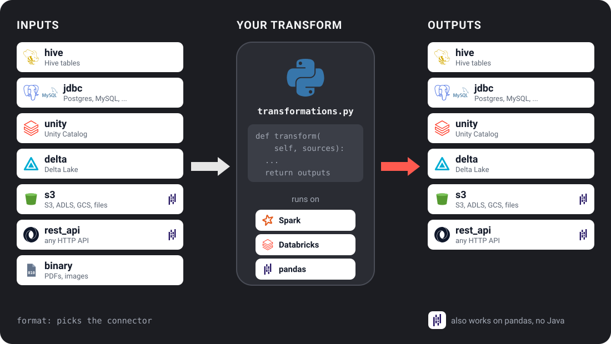

# Connectors: Overview

A connector reads or writes one kind of storage for you. You write `format: s3` (or
`jdbc`, `delta`, ...) on an input or output in `config.yaml`; the connector does the
reading before your transform runs, and the writing after. Your code only sees data
frames. This page lists the connectors and links to each one's settings.



---

## Built-in connectors

| Format | Reader | Writer | Notes |
|---|---|---|---|
| [`hive`](hive.md) | Yes | Yes | Hive Metastore via Spark SQL |
| [`jdbc`](jdbc.md) | Yes | Yes | PostgreSQL, MySQL, Oracle, SQL Server, ... |
| [`unity`](unity.md) | Yes | Yes | Databricks Unity Catalog (3-part names) |
| [`s3`](s3.md) | Yes | Yes | S3, ADLS, GCS, HDFS, local: any path. Also runs on the pandas backend |
| [`delta`](s3.md) | Yes | Yes | Delta Lake by path or table name; time travel |
| [`binary`](s3.md) | Yes | No | Raw files (PDFs, images). Spark's `binaryFile` source is read-only, so `format: binary` in `CONFIG.outputs` is rejected at config load |
| [`rest_api`](rest_api.md) | Yes | Yes | HTTP REST with auth, pagination, retry. Also runs on the pandas backend |

`s3` and `rest_api` work on every shipped backend (`spark`, `databricks`,
`pandas`). The others need Spark. `ubunye validate --backend pandas` says
before a run when a task uses a connector its backend cannot serve.

---

## Which connectors are installed

```bash
ubunye plugins
```

lists every connector this machine can use: the built-in ones above, plus any
installed from another package. An unknown `format:` is refused by
`ubunye validate`, with that list. How connectors are found and registered (entry
points) is in [Writing a Plugin](plugin_guide.md#registering-via-entry-points).

---

## Connector config structure

Every connector is declared as an `IOConfig` block:

```yaml
CONFIG:
  inputs:
    <name>:
      format: <format>          # selects the connector
      # connector-specific fields below
      options: {}               # raw Spark reader/writer options

  outputs:
    <name>:
      format: <format>
      mode: append              # the default; see Write modes
      options: {}
```

Connector-specific keys (e.g. `auth`, `pagination`) are passed to the connector
unchanged. Every built-in connector declares the keys it reads, so a key it does
not read is refused by `ubunye validate`. See
[Inputs & Outputs](../config/io.md) and its [write modes](../config/io.md#write-modes).

---

## Writing your own connector

See [Writing a Plugin](plugin_guide.md) for a step-by-step guide to building a
custom Reader or Writer and registering it with the entry point system.
