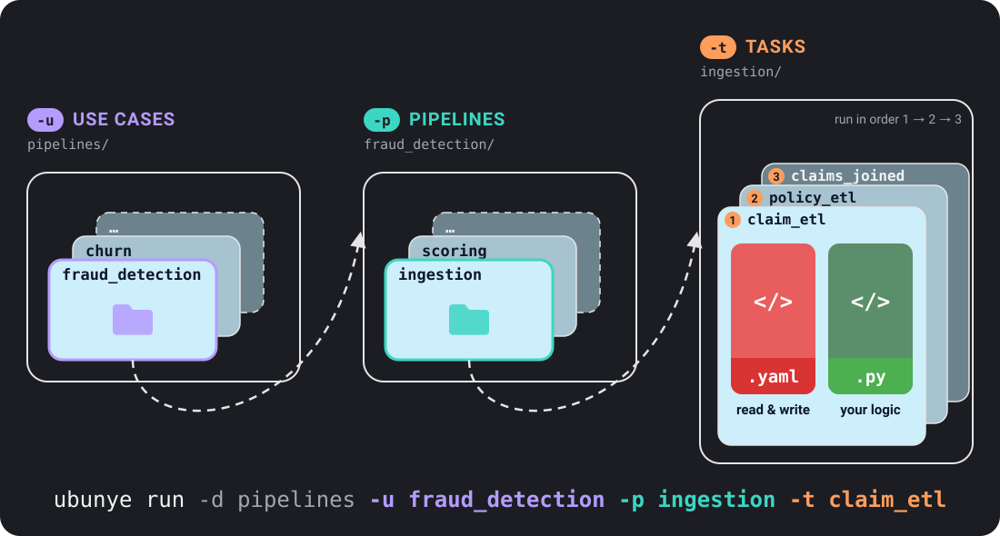

# Concepts

The words these docs use, each in one or two plain sentences, with a link to the page
that explains it in full. Read it once before your first task, or come back when a word
is new.

---

## Folders and names

| Word | What it means | More |
|---|---|---|
| **pipelines folder** | The top folder that holds all your use cases. You name it with `-d` (`--usecase-dir`), for example `-d pipelines`. | [Project Structure](structure.md) |
| **use case** | A folder for one business problem, such as `fraud_detection`. It holds pipelines. Named with `-u`. | [Project Structure](structure.md) |
| **pipeline** | A folder inside a use case that holds tasks which run in order, such as `ingestion`. Named with `-p` (`--pipeline`). | [Project Structure](structure.md) |
| **task** | One runnable unit of work: read some data, change it, write it. Named with `-t`. | [Project Structure](structure.md) |
| **task folder** | The folder that is a task. It holds `config.yaml` (what to read and write) and `transformations.py` (your code). In config templates it is `{{ task_dir }}`. | [Project Structure](structure.md#task-folder) |

So `ubunye run -d pipelines -u fraud_detection -p ingestion -t claim_etl` runs the task
folder `pipelines/fraud_detection/ingestion/claim_etl/`.

!!! note "Older name: package"
    Before 0.9 the middle level was called a package (`--package`). The CLI flag still
    works until 1.0, with a warning. Run records still name this field `package`, so
    when you read a record, `package` is the pipeline. See [Upgrading](../upgrading.md).

---

## Running a task

| Word | What it means | More |
|---|---|---|
| **profile** | A named set of engine settings under `ENGINE.profiles` in `config.yaml`, such as `DEV` or `PROD`. You pick one with `-m/--mode`; `run` uses `DEV` if you say nothing. Names must match exactly, case included. | [Engine and Profiles](../config/engine.md) |
| **backend** | What actually moves the data: `spark` (needs Java), `databricks` (the session a notebook already has) or `pandas` (no Java, one machine). Pick one with `--backend`. | [Execution Backends](../backends.md) |
| **connector** | The small plugin that reads from or writes to one kind of place. The `format:` key picks it, for example `format: s3` for files on any path, local or cloud, or `format: jdbc` for a database. | [Connectors](../connectors/overview.md) |
| **write mode** | The `mode:` key on an output: what happens to data already there. `overwrite`, `append`, `merge` or `overwrite_partitions`. | [Inputs and Outputs](../config/io.md#write-modes) |
| **expectations** | Checks on the data a task reads and writes, such as "no null ids". A failed check can stop the run, warn, or move bad rows to a quarantine output. Checks run before anything is written. | [Expectations](../config/expectations.md) |

---

## After a run

| Word | What it means | More |
|---|---|---|
| **run record** | A file a run leaves behind when you pass `--lineage`: when it ran, how it went, row counts, and a hash of the config, the code and every row read and written. `ubunye lineage list` and `ubunye lineage compare` read it. | [Run Records](../guides/run-records.md) |
| **batch** | A task with its `-dt` and `--var` values. Ubunye refuses to append the same batch twice unless you pass `--rerun`. | [Safe Reruns](../guides/safe-reruns.md) |

---

## Next steps

- [Quickstart →](quickstart.md)
- [Project Structure →](structure.md)
- [Config Reference →](../config/overview.md)
