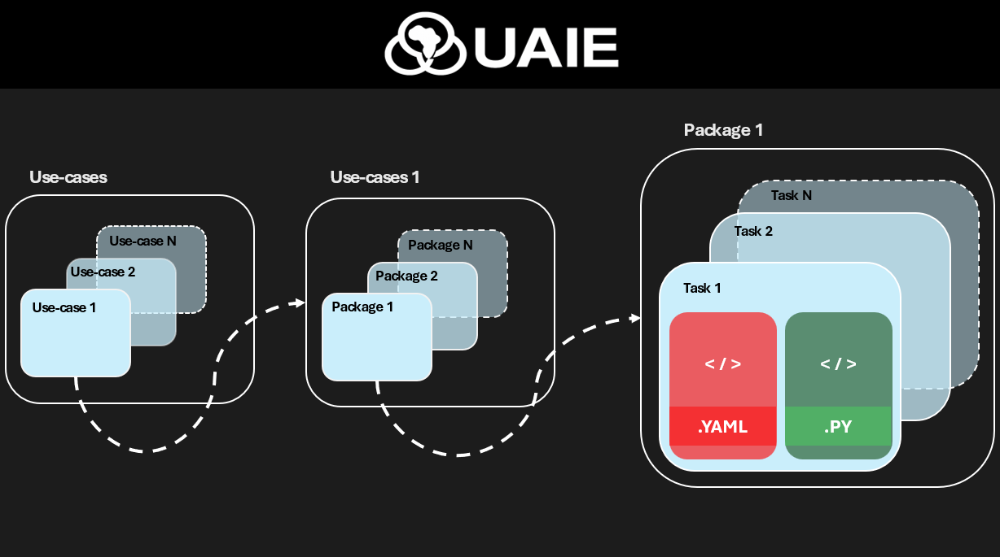

# Project Structure

A typical Ubunye project lays out pipelines by **use-case → package (pipeline) → task**,
mirroring how `ubunye init` and `ubunye run` address tasks.



---

## Recommended layout

```
my_project/
├── pipelines/                     ← root task directory (-d flag)
│   ├── fraud_detection/           ← use-case (-u flag)
│   │   └── ingestion/             ← package, the pipeline (-p flag)
│   │       └── claim_etl/         ← task (-t flag)
│   │           ├── config.yaml
│   │           ├── transformations.py
│   │           ├── data/people.csv          ← sample input (`ubunye init`, local template)
│   │           └── notebooks/
│   │               └── claim_etl_dev.ipynb  ← interactive dev notebook
│   └── .ubunye/
│       └── lineage/               ← run records (--lineage flag), under the -d folder
├── .ubunye/
│   └── model_store/               ← model registry artifacts (wherever your config's store points)
└── pyproject.toml
```

---

## Task folder

| File | Purpose |
|---|---|
| `config.yaml` | Declares inputs, transform, outputs, engine, orchestration |
| `transformations.py` | Python transform (`Task` subclass) |
| `model.py` | Optional ML model (`UbunyeModel` subclass), imported by `transformations.py` |
| `data/` | Sample input that `ubunye init` writes (local template); the config reads it through `{{ task_dir }}` |
| `notebooks/<task>_dev.ipynb` | Interactive dev notebook (Databricks-ready) |

Every task is **self-contained**. The config is the single source of truth for what runs and where.

---

## config.yaml skeleton

```yaml
MODEL: etl          # or ml
VERSION: "1.0.0"    # semver

ENGINE:
  spark_conf:
    spark.sql.shuffle.partitions: "200"
  profiles:
    DEV:              # the default mode; names are case-sensitive
      spark_conf:
        spark.sql.shuffle.partitions: "4"

CONFIG:
  inputs:
    my_input:
      format: hive
      db_name: raw
      tbl_name: events

  transform: {}        # optional: leave out type to use the Task class in transformations.py

  outputs:
    my_output:
      format: delta
      path: s3://bucket/clean/events
      mode: overwrite

ORCHESTRATION:
  type: airflow
  schedule: "0 2 * * *"
  retries: 3
  owner: data-engineering
```

---

## Engine library layout (reference)

```
ubunye/
├── api.py          : Public Python API (run_task, run_pipeline)
├── core/           : runtime, task runner, interfaces (Reader/Writer/Transform/Task/Backend), expectations, planning
├── config/         : YAML loader, Jinja resolver, Pydantic schema
├── backends/
│   ├── spark_backend.py      : Creates new SparkSession
│   ├── databricks_backend.py : Reuses active SparkSession (Databricks)
│   └── pandas_backend.py     : pandas and pyarrow, no Java
├── plugins/
│   ├── readers/    : hive, jdbc, unity, rest_api, s3, delta, binary
│   ├── writers/    : s3, jdbc, unity, rest_api, delta, hive
│   ├── transforms/ : noop, model_transform
│   └── ml/         : BaseModel, SklearnModel, SparkMLModel (internal wrappers)
├── models/         : UbunyeModel contract, loader, registry, gates, artifact stores
├── cli/            : main plus one module per command group (lineage, models, deploy, prove, gate, ...)
├── lineage/        : RunContext, LineageRecorder, FileSystemLineageStore, OpenLineage, FOCUS
├── deploy/         : Databricks, Glue, Dataproc, EMR Serverless, Kubernetes, Container Apps
├── orchestration/  : Airflow, Databricks job and Spark pipeline exporters
└── telemetry/      : events, mlflow, prometheus, otel, hooks/
```

---

## Environment profiles

Profiles let you override Spark config without duplicating YAML:

```yaml
ENGINE:
  spark_conf:
    spark.executor.memory: "8g"
  profiles:
    DEV:
      spark_conf:
        spark.executor.memory: "512m"
        spark.sql.shuffle.partitions: "4"
    PROD:
      spark_conf:
        spark.executor.memory: "32g"
```

Select at runtime:

```bash
ubunye run -d pipelines -u fraud -p etl -t claims            # -m defaults to DEV
ubunye run -d pipelines -u fraud -p etl -t claims -m PROD
```

Or via the Python API:

```python
import ubunye

ubunye.run_task(task_dir="pipelines/fraud/etl/claims", mode="PROD")
```

Profile names are matched exactly: `-m prod` does not find a `PROD` profile. When a
config has profiles and none matches the mode, the run stops with an error that lists
the profiles it has. A config with no profiles runs in any mode.

---

## Next steps

- [Config Reference →](../config/overview.md)
- [Connectors →](../connectors/overview.md)
- [CLI Reference →](../cli.md)
