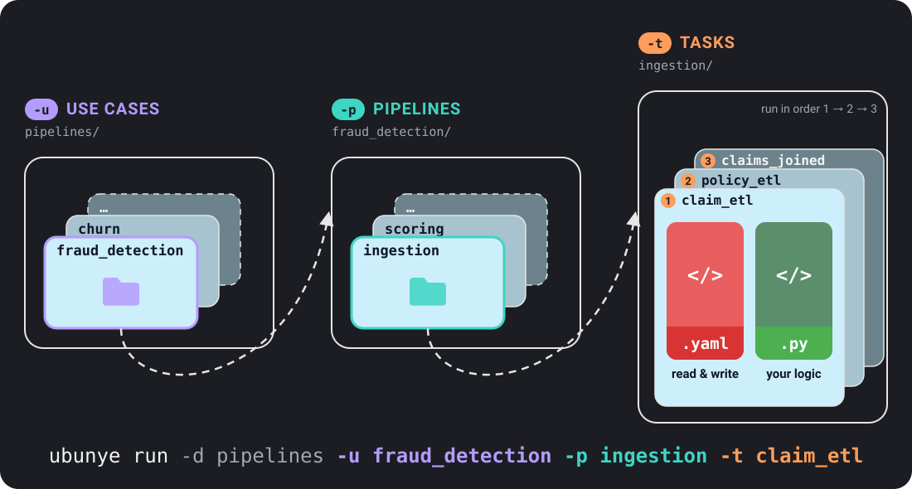

# Project Structure

A Ubunye project has three levels of folders: a **use case** holds **pipelines**, and a
pipeline holds **tasks** that run in order. A task is one folder with a `config.yaml` (what
to read and write) and a `transformations.py` (how to change the data). The folder path and
the `ubunye run` flags name the same task.



---

## Recommended layout

This example has one use case, `fraud_detection`, with two pipelines. The `ingestion`
pipeline has two tasks, and the `claim_etl` task folder is shown in full:

```
my_project/
├── pipelines/                     ← pipelines folder (-d)
│   ├── fraud_detection/           ← use case (-u)
│   │   ├── ingestion/             ← pipeline (-p)
│   │   │   ├── claim_etl/         ← task (-t): this folder is the task folder
│   │   │   │   ├── config.yaml
│   │   │   │   ├── transformations.py
│   │   │   │   ├── data/claims.csv              ← sample input the config reads
│   │   │   │   └── notebooks/
│   │   │   │       └── claim_etl_dev.ipynb      ← notebook for trying it step by step
│   │   │   └── policy_etl/        ← another task in the same pipeline
│   │   └── risk_scoring/          ← another pipeline
│   └── .ubunye/
│       ├── lineage/               ← run records (--lineage), under the -d folder
│       └── leases/                ← which batches already ran (safe reruns)
├── .ubunye/
│   └── model_store/               ← model registry files (wherever your config's store points)
└── pyproject.toml
```

To run the `claim_etl` task: `ubunye run -d pipelines -u fraud_detection -p ingestion -t claim_etl`.

`ubunye init -d pipelines -u fraud_detection -p ingestion -t claim_etl` makes the
`claim_etl` folder for you. Its starter sample is `data/people.csv` with a task that keeps
the adults (the one in the [Quickstart](quickstart.md)); replace both with your own data
and code.

---

## Task folder

| File | Purpose |
|---|---|
| `config.yaml` | Declares inputs, transform, outputs, engine, orchestration |
| `transformations.py` | Python transform (`Task` subclass) |
| `model.py` | Optional ML model (`UbunyeModel` subclass), imported by `transformations.py` |
| `data/` | Optional sample input. The config reads it through `{{ task_dir }}`, which is the task folder |
| `notebooks/<task>_dev.ipynb` | Interactive dev notebook (Databricks-ready) |

Every task is **self-contained**. The config is the single source of truth for what runs and where.

---

## config.yaml skeleton

This one runs as it stands, on pandas or Spark: it reads the CSV in the task folder and
writes Parquet next to it. `format: s3` is the file connector; `s3` means any file path,
local or in the cloud.

```yaml
MODEL: etl          # or ml
VERSION: "1.0.0"    # semver

ENGINE:             # Spark settings; the pandas backend ignores them
  spark_conf:
    spark.sql.shuffle.partitions: "200"
  profiles:
    DEV:            # the default profile; names are matched exactly, case included
      spark_conf:
        spark.sql.shuffle.partitions: "4"
    PROD:
      spark_conf:
        spark.sql.shuffle.partitions: "400"

CONFIG:
  inputs:
    claims:
      format: s3
      path: "{{ task_dir }}/data/claims.csv"
      file_format: csv
      options:
        header: "true"
        inferSchema: "true"

  transform: {}     # optional: leave out type to use the Task class in transformations.py

  outputs:
    clean_claims:
      format: s3
      path: "{{ task_dir }}/output/clean_claims"
      file_format: parquet
      mode: overwrite   # the write mode

ORCHESTRATION:      # optional: used by `ubunye export`, not by `ubunye run`
  type: airflow
  schedule: "0 2 * * *"
  retries: 3
  owner: data-engineering
```

On Spark you can also read and write tables, for example `format: hive` (with `db_name`
and `tbl_name`) or `format: delta`. Those need Spark: the pandas backend cannot serve
`hive`, `jdbc`, `unity` or `delta`, and `ubunye plan --backend pandas` says so before a
run. See [Connectors](../connectors/overview.md).

---

## Environment profiles

A profile is a named set of Spark settings under `ENGINE.profiles`, picked with
`-m/--mode`. Profiles let you change Spark settings per environment without copying the
YAML:

```yaml
ENGINE:
  spark_conf:
    spark.executor.memory: "8g"
  profiles:
    DEV:
      spark_conf:
        spark.executor.memory: "512m"
        spark.sql.shuffle.partitions: "4"
    PROD:
      spark_conf:
        spark.executor.memory: "32g"
```

Select at runtime:

```bash
ubunye run -d pipelines -u fraud_detection -p ingestion -t claim_etl           # -m defaults to DEV
ubunye run -d pipelines -u fraud_detection -p ingestion -t claim_etl -m PROD
```

Or via the Python API:

```python
import ubunye

ubunye.run_task(task_dir="pipelines/fraud_detection/ingestion/claim_etl", mode="PROD")
```

Profile names are matched exactly: `-m prod` does not find a `PROD` profile. When a
config has profiles and none matches the mode, the run stops with an error that lists
the profiles it has. A config with no profiles runs in any mode. More on profiles:
[Engine and Profiles](../config/engine.md).

---

## Next steps

- [Concepts →](concepts.md)
- [Config Reference →](../config/overview.md)
- [Connectors →](../connectors/overview.md)
- [CLI Reference →](../cli.md)
