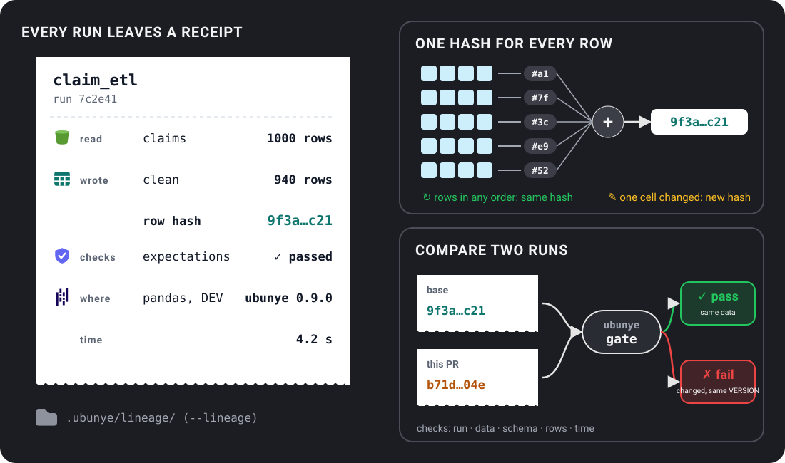

# Run records

A run record is what one run leaves behind: what it read, what it wrote, how
many rows, a hash of every row, and the code, config and machine it ran with.
This guide is for anyone who wants to know what a run did, or whether two runs
gave the same data.

- **The problem:** a job ran, and you need to know what it read, what it wrote,
  and whether today's output is the same as yesterday's.
- **When to use it:** on every run you may need to explain later, and in CI to
  catch a change in the data before it merges.
- **The one command:** add `--lineage` to `ubunye run`.

```bash
ubunye run -d pipelines -u demo -p starter -t filter_adults --backend pandas --lineage -dt 2026-11-01
```



The examples below use the task `ubunye init -d pipelines -u demo -p starter -t filter_adults`
makes, run on the pandas backend. The output is real.

## Make one

```bash
ubunye run -d pipelines -u demo -p starter -t filter_adults --backend pandas --lineage -dt 2026-11-01
```

```text
Starting task: filter_adults (Mode: DEV, Deploy: client)
[OK] Run complete for filter_adults
```

`ubunye test run` writes a run record by default (`--no-lineage` turns it off).
In Python, pass `lineage=True` to `ubunye.run_task` or `ubunye.run_pipeline`.

## Where it is stored

By default, one JSON file per run under the pipelines folder:

```text
pipelines/.ubunye/lineage/demo/starter/filter_adults/129fca30-185a-427d-b98a-7cf0c8dc9022.json
```

That is the `filesystem` store. Jobs that share no disk can share a Delta table
instead (`--lineage-backend delta`). Every store and its flags:
[Where run records are stored](../cli.md#where-run-records-are-stored).

## What it holds

| Part | Fields | What it tells you |
|---|---|---|
| Who | `run_id`, `task_path`, `usecase`, `package` (the pipeline), `task_name`, `profile`, `model`, `version` | Which task ran, with which profile and task version |
| When | `started_at`, `ended_at`, `duration_sec`, `timings` (each read, transform and write) | How long it took, and where the time went |
| Outcome | `status` (`success`, `error`, `running`, `interrupted`), `error` | Whether it worked |
| Inputs and outputs | `name`, `location`, `row_count`, `schema_hash`, `data_hash` | What was read and written, and a hash over every row |
| Code and config | `code_hash`, `config_hash`, `variables` (`dt`, `--var`, `mode`) | Whether the code or config changed |
| Environment | `environment` (Python, platform, package versions), `environment_hash`, `backend`, `engine_version` | What it ran on |
| Who and where ran it | `environment.identity`: `platform`, `workspace`, `job_id`, `job_run_id`, `task_key`, `run_by`, `git_commit`, `git_branch`, `deploy_target` (a field that was not found is left out) | Which job, run, person and commit, so a table leads back to the deploy that wrote it. Not part of `environment_hash`. See [ADR 015](../architecture/adr-015-run-identity-and-job-settings.md) and [Databricks job parameters](../deployment/databricks.md#job-parameters-ubunye-reads) |
| Other | `expectations`, `llm_calls`, `llm_budget`, `model_runs`, `time_zone` | Data checks, model calls and model training, when the task has them |

## Read one

List the runs of a task, newest first:

```bash
ubunye lineage list -d pipelines -u demo -p starter -t filter_adults
```

```text
------------------------------------------------------------
Task: demo/starter/filter_adults
------------------------------------------------------------
RUN_ID     STARTED              STATUS        DUR  ROWS
------------------------------------------------------------
cf99c8f0  2026-11-10T10:36:01  success      0.2s  in:8  out:5
129fca30  2026-11-10T10:35:55  success      0.3s  in:8  out:5
```

Show one (the latest, or `--run-id`), as JSON:

```bash
ubunye lineage show -d pipelines -u demo -p starter -t filter_adults
```

```json
{
  "run_id": "129fca30-185a-427d-b98a-7cf0c8dc9022",
  "task_path": "demo/starter/filter_adults",
  "profile": "DEV",
  "config_hash": "sha256:10b2e1c5...",
  "status": "success",
  "inputs": [
    {
      "name": "people",
      "location": ".../filter_adults/data/people.csv",
      "row_count": 8,
      "schema_hash": "sha256:9c8ec3b8...",
      "data_hash": "sha256:00d7526f...",
      "hash_method": "rows-v1",
      "source_version": {"kind": "files", "files": 1, "bytes": 163, "etags": false, "...": "..."}
    }
  ],
  "outputs": [
    {"name": "adults", "row_count": 5, "data_hash": "sha256:622fcbc6...", "...": "..."}
  ],
  "backend": "pandas",
  "variables": {"dt": "2026-11-01", "mode": "DEV"},
  "code_hash": "sha256:b6e66360...",
  "environment_hash": "sha256:9753dc49...",
  "...": "..."
}
```

(Shortened here; the real output prints every field.) `ubunye lineage trace`
prints the same run as a readable inputs, transform, outputs picture, and
`ubunye lineage search -d pipelines` searches every task. Every flag:
[`ubunye lineage`](../cli.md#ubunye-lineage).

## Compare two runs

`lineage compare` puts two records side by side. Here the input file was saved
with its rows in the opposite order, then run again:

```bash
ubunye lineage compare -d pipelines -u demo -p starter -t filter_adults \
    --run-id1 129fca30-185a-427d-b98a-7cf0c8dc9022 --run-id2 cf99c8f0-dd67-43c5-8e73-5080235048bb
```

```text
  status: success  (unchanged)
  duration_sec: 0.2550354539998807 -> 0.23477902000013273  CHANGED
  config_hash: sha256:10b2e1c5...  (unchanged)
  code_hash: sha256:b6e66360...  (unchanged)
  environment_hash: sha256:9753dc49...  (unchanged)
  Input 'people':
      row_count: 8  (unchanged)
      schema_hash: sha256:9c8ec3b8...  (unchanged)
      data_hash: sha256:00d7526f...  (unchanged)
  Output 'adults':
      row_count: 5  (unchanged)
      schema_hash: sha256:9c8ec3b8...  (unchanged)
      data_hash: sha256:622fcbc6...  (unchanged)
```

Same rows in another order: same hash. Now one cell changes (Lerato's age, 22
to 23):

```text
  Input 'people':
      row_count: 8  (unchanged)
      data_hash: sha256:00d7526f... -> sha256:b1b01fe5...  CHANGED
  Output 'adults':
      row_count: 5  (unchanged)
      data_hash: sha256:622fcbc6... -> sha256:1e274b72...  CHANGED
```

The row counts match, but the hashes catch the change.

A data hash is compared only when both runs made it the same way. Two missing
hashes show as "unknown", and a record from before 0.7.0 (which hashed a
sample) shows as "not comparable" with a newer one.

### In CI: `ubunye gate`

`gate` compares the latest run with the one before (or any two) and exits 1
when the data changed without a version bump, or the run got slower or lost rows
past a limit you set:

```bash
ubunye gate -d pipelines -u demo -p starter -t filter_adults
```

```text
gate: demo/starter/filter_adults  cf99c8f0 -> 99b6d52a
[OK] run succeeded
[FAIL] data adults: changed without a VERSION bump (still 0.1.0); changed: input people

fails.
```

Setting it up in a pull request: [Gate](../patterns/gate.md).

## What the hash promises

The data hash (`rows-v1`) is made from every row, not a sample.

| Promise | What it means for you |
|---|---|
| Every row counts | All rows are hashed, in the same pass as the row count |
| Row order does not matter | A shuffle or repartition gives the same hash |
| Column order does not matter | Columns are sorted by name first |
| One changed cell changes it | Any different value gives a different hash |
| Null is not NaN | The two give different hashes |
| Same on every engine | pandas and Spark give the same hash for the same data and types |

If the rows cannot be read, the record has no data hash and says why
(`hash_error`). It never puts the schema hash in its place.

## What an input's hash covers

An output is hashed from what the run wrote. An input is hashed from what the
run read, but on Spark that happens at the end of the task, by reading the
source again. So the record takes the source's version when the input is read,
and again right after the hash. When the two differ, it says so:

```json
"source_version": {"kind": "files", "files": 2, "bytes": 2030, "etags": false, "listing_hash": "sha256:..."},
"source_version_at_hash": {"kind": "files", "files": 2, "bytes": 2034, "etags": false, "listing_hash": "sha256:..."},
"source_changed": true,
"source_note": "The source changed between the read and the hash (2 files, 2030 bytes -> 2 files, 2034 bytes). This digest is of the later state, not of what the task read."
```

What the version is, by kind of input:

| Input | Its version |
|---|---|
| Files | `files`, `bytes`, `latest_modified`, `etags`, `listing_hash`, from Spark's own file index; nothing is read. Where the file system gives no content tags (`etags: false`: a local disk, HDFS), "unchanged" means the names, sizes and times are the same, and the note says so |
| Delta | The read is pinned to one version (by the config, or by the engine when the config names none), so the note says the hash is of what was read, and gives the table's `latest_version` at the hash as information |
| A SQL query, JDBC, a catalog table that is not Delta | `"kind": "none"`, with the reason |
| A listing that failed or took longer than `UBUNYE_SOURCE_VERSION_TIMEOUT` seconds (default 30) | `"kind": "none"`, with the reason |
| Any input on pandas | Recorded, but not checked again: the input is in memory, so the hash is of what was read |

With `LineageRecorder(hash_inputs=False)` no version is taken.
`ubunye lineage trace` prints the note, and `lineage compare` and `ubunye gate`
do not treat such an input's hash as evidence.

## Large tables

On pandas, a table of 500,000 rows or more is hashed by helper processes. How
many, how much memory, and how to cap them:
[The run record uses helper processes](../backends.md#the-run-record-uses-helper-processes).

Why it works this way: [ADR 006](../architecture/adr-006-run-record.md),
[ADR 011](../architecture/adr-011-run-record-stores.md).
