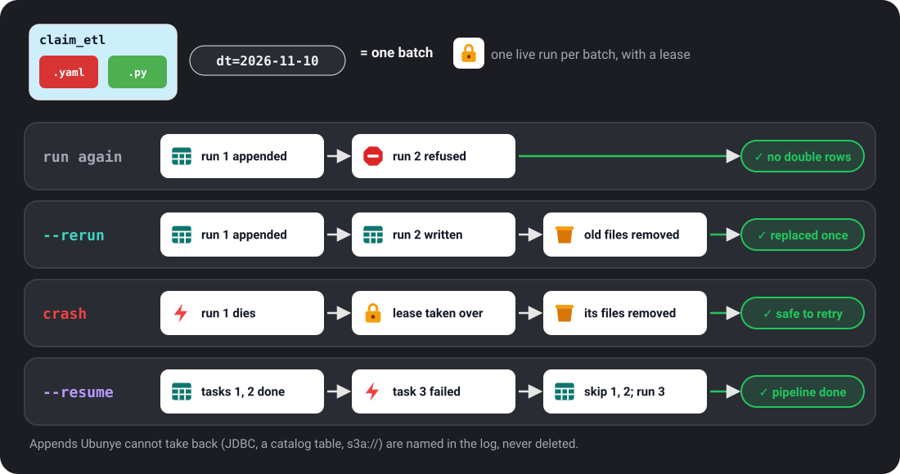

# Safe reruns

How Ubunye stops a batch landing twice when you run a task again, and how to
replace or finish one on purpose. For anyone who runs jobs on a schedule or
reruns a failed day.

- **The problem:** a task that **appends** adds rows each time it runs. Run the
  same day twice, by hand or by a retry, and that day's rows are in the table
  twice.
- **When it bites:** a scheduler retries a job; you rerun a backfill; a pipeline
  stopped half way and you start it again; a run crashed after it wrote.
- **The one command:** run it again with `--rerun` to replace the batch, or
  `--resume` to finish a pipeline.

```bash
ubunye run -d pipelines -u shop -p daily -t load_orders -dt 2026-11-01 --rerun
```



## Words used here

- **Batch:** one task with its `-dt` and every `--var` value. `-m` and `-dtf` on
  their own do not name a batch, but `-dtf` is part of it once `-dt` is given.
  A run with no `-dt` and no `--var` has no batch, so nothing here applies to it.
- **Append task:** a task with at least one output whose write mode is `append`.
  An output with no `mode` counts as append, since most writers default to it.
- **Overwrite task:** a task whose outputs all replace what is there
  (`overwrite`, `overwrite_partitions`, `merge`). These were already safe to rerun.

## See it work

Two tasks from `ubunye init`, run on pandas: `load_orders` appends, `summarise`
overwrites.

**Run a finished batch again: refused.**

```bash
ubunye run -d pipelines -u shop -p daily -t load_orders -dt 2026-11-01 --backend pandas
ubunye run -d pipelines -u shop -p daily -t load_orders -dt 2026-11-01 --backend pandas
```

```text
Starting task: load_orders (Mode: DEV, Deploy: client)
[ERROR] Run refused for load_orders: shop/daily/load_orders already finished this batch (run 61475466 (finished 2026-11-10T10:35:29Z)) and appends to adults: running it again would add the batch twice.

  Finished: .../pipelines/.ubunye/leases/shop/daily/load_orders/08e84f1b8a561918.finished.json
  Hint: To replace the batch, run again with --rerun (rerun=True in Python). If each run adds new data to the same batch, give each run its own variable, for example --var hour=13.
```

It exits 1 with one line, no traceback. Nothing was written.

**Replace it: `--rerun`.**

```bash
ubunye run -d pipelines -u shop -p daily -t load_orders -dt 2026-11-01 --backend pandas --rerun
```

```text
Starting task: load_orders (Mode: DEV, Deploy: client)
--rerun: replacing the batch written by run 61475466 (finished 2026-11-10T10:35:29Z); its 1 file(s) are removed once this run succeeds.
Replaced the batch: removed 1 file(s) of the earlier run.
[OK] Run complete for load_orders
```

**Finish a pipeline that stopped half way: `--resume`.** Here `load_orders`
finished `2026-11-02` and `summarise` never ran:

```bash
ubunye run -d pipelines -u shop -p daily -t load_orders -t summarise -dt 2026-11-02 --backend pandas --resume
```

```text
Starting task: load_orders (Mode: DEV, Deploy: client)
[SKIP] load_orders already finished this batch (--resume); kept as it is.
Starting task: summarise (Mode: DEV, Deploy: client)
[OK] Run complete for summarise
```

In Python: `run_task(..., rerun=True)`, `run_pipeline(..., rerun=True)` and
`run_pipeline(..., resume=True)`. A task skipped by `resume` is not in the
result.

## The rules, per kind of output

What happens when an append task's batch runs again, after it finished or after
a crash:

| Output | Run again (finished) | `--rerun` | After a crash or failure |
|---|---|---|---|
| Files on a local or shared disk, pandas | Refused | The earlier run's files are removed once the new run succeeds | The run's own files are taken back |
| Files on a local or shared disk, Spark (`parquet`, `csv`, `json`, `orc`, `avro`, `text`) | Refused | As for pandas | As for pandas |
| Delta (path or table), with `replace_where` | Refused | The batch's rows are replaced in one commit | The rerun replaces the batch's rows |
| Delta (path or table), no `replace_where` | Refused | Appended again, and the run warns at its start | A retry adds nothing: Delta skips a batch it already committed, and the run warns that the batch was already there |
| JDBC, with `replace_where` | Refused | Staged, then moved in by one transaction that replaces the batch's rows | A kill before the commit changes nothing; after it, the rerun replaces the batch |
| JDBC, no `replace_where` | Refused | Appended again, and the run says so | Named in the log and the run record, not repaired |
| A catalog table that is not Delta | Refused | Appended again, and the run says so | Named, not repaired |
| Spark to object storage (`s3a://`, `abfss://`, `gs://`, `dbfs:/`) or HDFS | Refused | Appended again, and the run says so | Named, not repaired |

For an output in the last three rows that must land once, write it with
`mode: overwrite_partitions` and `partitionBy`, or `overwrite`, or `merge`. How
to set `replace_where`: [Files and Delta](../connectors/s3.md) and
[JDBC](../connectors/jdbc.md).

### Overwrite tasks

Never refused. An `overwrite` output is replaced in one step, and
`overwrite_partitions` replaces only the partitions the new data fills, so a
rerun of a day replaces that day. Write modes: [Inputs and outputs](../config/io.md).

### `--rerun`

- Replaces a batch a finished run appended. Use it for a backfill or a
  correction.
- The earlier run's files are removed only after the new run has committed. A
  crash before that keeps the old batch (the new files are taken back); a crash
  after it is finished by the next run.
- It removes the files the earlier run wrote, wherever they are, even if the
  output's path changed since. Files moved or compacted by something else since
  are not found: `--rerun` then removes nothing and appends, and the log says how
  many files it removed.
- Why not replace by default: an hourly job with the same `-dt` would then
  delete the morning's rows at noon. If each run adds new rows to the same
  batch, give each run its own variable instead, such as `--var hour=13`.

### `--resume`

- Skips each task that already finished this batch, with `[SKIP]`, and runs the
  rest.
- A task that appends is known to have finished from its output. A task that
  only overwrites is known to have finished only from its run records: with
  `--lineage` it is skipped when its latest run of the batch succeeded; without
  `--lineage` it runs again. That is safe (it replaces its output), but it does
  the work twice.
- Why not skip by default: in an hourly pipeline (same `dt`, one task appends,
  the next overwrites) a silent skip dropped the first task's new rows and exited 0.

### Two runs at once, crashes and leases

- **A lease per batch.** While a run works, it holds a lease: a small file under
  `<pipelines folder>/.ubunye/leases/`, naming the run, its process, host and a
  heartbeat. A second run of the same batch is refused while the first lives,
  naming it. Runs of different batches never block each other.
- **A dead run is taken over.** A lease whose process is gone (same machine), or
  whose file has not been touched for 15 minutes (another machine on a shared
  disk), belongs to a dead run. The next run takes it over, marks the dead run's
  record `interrupted`, and takes back the files it appended.
- **Only a run's own files are removed.** Each file is claimed in the lease
  before it lands. No output folder is ever listed to decide what to delete, so
  another run's files are never touched.
- **A file that cannot be removed** (a reader has it open, common on Windows)
  stays in the lease: the next run takes it back, or refuses and names the file.
- **A run that lost its lease stops**, and its record says `interrupted`, never
  `success`.
- **Do not delete a lease** of a run that may be alive: it holds that run's
  claims.
- **A finished run** leaves `<key>.finished.json` beside its lease. That note is
  what makes the next run of the batch refuse. Notes are small, one per task and
  batch, and nothing removes them.
- **On by default.** `UBUNYE_RUN_LEASE=off` turns leases off; then a run appends
  plainly (Delta `replace_where` still replaces).

### What it does not cover

- **Cloud jobs on their own disks.** The lease and the finished note live in the
  pipelines folder, so they protect runs that share it: one machine, or a shared
  disk. A cloud job that starts on a fresh disk sees neither.
- **A different spelling is a different batch.** The same `-dt` with another
  `-dtf`, another `-m` spelling or an extra `--var` is not refused while the
  first runs, and does not take back a dead run's files. Rerun with the same
  values.
- **Batches finished before 0.8** left no note, so they are not refused.
- **macOS:** a process start time is not read, so a dead run whose process id was
  reused looks alive until that process ends.
- **Lineage off, narrow window:** a successful run killed after its success is
  recorded but before it marks its lease done counts as finished when lineage is
  on. With lineage off, the next run can take its appends back and write the
  batch itself.
- **Delta retention:** Delta forgets a committed batch after
  `delta.setTransactionRetentionDuration`, when a table sets it; a retry after
  that appends again. A config that sets its own `txnAppId` or `txnVersion` is
  left alone.
- **JDBC with `replace_where`** needs a classic Spark session (Spark Connect is
  refused with a clear error) and a database user that may create and drop a
  table in the target's schema. The predicate is in the database's SQL dialect.

Why: [ADR 008](../architecture/adr-008-rerun-safety.md).
