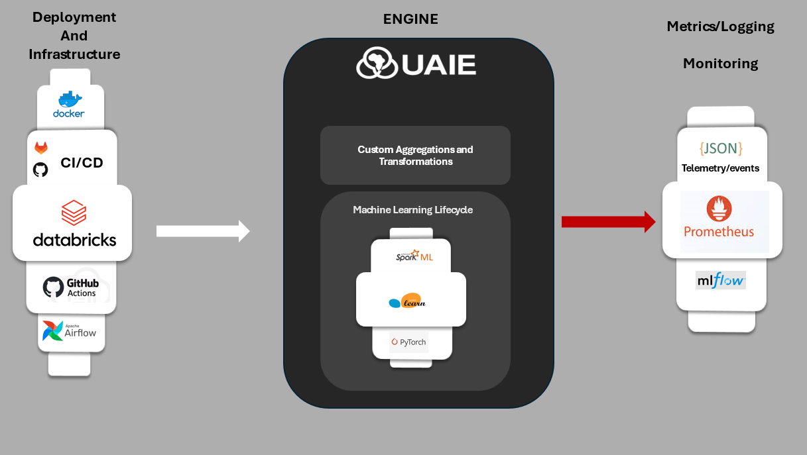

# Ubunye Engine

Ubunye Engine is a **config-first framework** for data and ML pipelines. A task is a
folder: run it on a laptop with no Java (pandas), or on Spark anywhere (locally, on a
cluster, on Databricks), and every run leaves a record you can check.

The same task, unchanged, has given the same rows on pandas, local Spark, Kubernetes,
AWS Glue, GCP Dataproc, Azure Container Apps and Databricks, checked from the run
records by the [proving ground](proving-ground/index.md)
([latest results](proving-ground/latest.md)).

Define your pipeline in YAML. Write a Python class. Run it.



---

[**Get started in 5 minutes →**](getting_started/quickstart.md){ .md-button .md-button--primary }
[**GitHub →**](https://github.com/ubunye-ai-ecosystems/ubunye_engine){ .md-button }

---

## Why Ubunye?

| Concern | How Ubunye handles it |
|---|---|
| I/O boilerplate | Declarative connectors (Hive, JDBC, S3 and local files, Delta, REST API, Unity Catalog, binary files) |
| Config drift between environments | Jinja2 templating + per-profile Spark overrides |
| Bad data | Expectations: input contracts, quarantine of bad rows, reconcile between input and output |
| ML lifecycle management | Library-independent `UbunyeModel` contract + built-in registry |
| Observability | Run records with `--lineage`, OpenLineage export, Prometheus, OpenTelemetry, MLflow |
| Orchestration | One-command export to an Airflow DAG, a Databricks job or a Spark Declarative Pipeline |
| Deployment | `ubunye deploy` to Databricks, AWS Glue, GCP Dataproc, EMR Serverless, Kubernetes, Azure Container Apps |
| Testing | A unit tier with no Java, a Spark tier, and a parity tier that checks Spark and pandas agree |

## Key Features

- **Config-first**: all I/O, compute, and orchestration is YAML-driven; no hardcoded credentials or paths.
- **Backends**: run on Spark, Databricks, or pandas with no Java (`--backend`); `ubunye backends` lists what each can do.
- **Checks before a run**: `ubunye validate`, `ubunye plan` (a dry run) and `ubunye doctor` (this machine).
- **Plugin system**: extend via Python entry points (`ubunye.readers`, `ubunye.writers`, `ubunye.transforms`, `ubunye.backends` and more).
- **Model registry**: version, promote, rollback, and gate ML models without coupling to any ML library.
- **Run records**: `--lineage` writes one per run to `.ubunye/lineage/`, with a hash of every row; `ubunye gate` and `ubunye prove` compare them.
- **Safe reruns**: a batch that was already appended is refused unless you pass `--rerun`; `--resume` finishes a pipeline that stopped half way.
- **Telemetry-ready**: Prometheus, OpenTelemetry, and JSON event logs through hooks (`ubunye.hooks`).
- **Orchestration export**: generate Airflow DAGs, Databricks job JSON or a Spark Declarative Pipeline from the same config.
- **Agents**: `ubunye mcp` serves the engine over MCP (read-only unless you pass `--allow-run`).

## Two entry points

=== "CLI"

    ```bash
    ubunye run -d pipelines -u fraud -p etl -t claims -m PROD --lineage
    ```

=== "Python API (Databricks)"

    ```python
    import ubunye

    outputs = ubunye.run_task(
        task_dir="pipelines/fraud/etl/claims",
        mode="PROD",
        dt="2024-06-01",
    )
    ```

The Python API auto-detects and reuses an active SparkSession on Databricks.
When no session exists, it creates one, the same as the CLI. Pass `backend="pandas"`
to run with no Spark at all.

## Quick Example

```yaml
# pipelines/fraud/etl/claims/config.yaml
MODEL: etl
VERSION: "1.0.0"

CONFIG:
  inputs:
    raw_claims:
      format: hive
      db_name: raw
      tbl_name: claims
  transform: {}
  outputs:
    clean_claims:
      format: delta
      path: s3://data-lake/clean/claims
      mode: overwrite
```

```bash
ubunye plan -d pipelines -u fraud -p etl -t claims   # what it will read and write
ubunye run  -d pipelines -u fraud -p etl -t claims
```

`-m PROD` selects a profile under `ENGINE.profiles`; this config has none, so it runs
in the default mode, `DEV`.

## Documentation Map

- [Installation](getting_started/install.md): install, verify, extras
- [Quickstart](getting_started/quickstart.md): end-to-end in 5 minutes
- [Tutorials](tutorials/01-local-parity.md): same result on pandas and Spark; a multi-table pipeline with data checks
- [Config Reference](config/overview.md): full YAML schema
- [Connectors](connectors/overview.md): all built-in readers and writers
- [Execution Backends](backends.md): Spark, Databricks, pandas
- [ML: Model Contract](ml/model_contract.md): the `UbunyeModel` ABC
- [ML: Registry](ml/registry.md): versioning, promotion, gates
- [CLI Reference](cli.md): all commands and flags
- [API Reference](api.md): Python API (`run_task`, `run_pipeline`)
- [Deployment](deployment.md): Databricks, AWS, GCP, Azure, Kubernetes
- [Proving ground](proving-ground/index.md): one workload compared across environments
- [Developer Guide](dev_guide.md): architecture, plugins, testing
