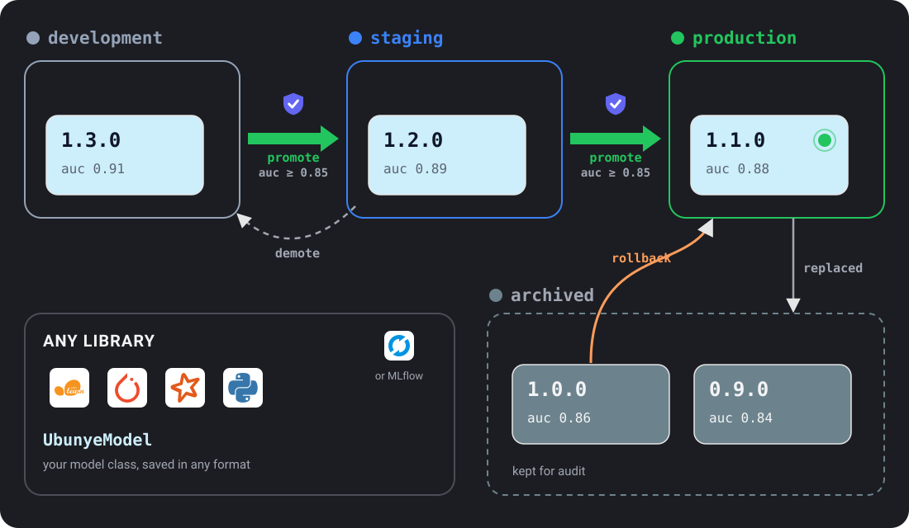

# Model Registry

For anyone who trains models with Ubunye and needs to keep versions, move them
from test to live, and roll back. The registry works with any ML library.

- **The problem:** you train a new model every week. You need to know which
  version is live, which data made it, and you need a safe way to swap it.
- **When to use it:** as soon as a model leaves your laptop.
- **The one command:** `ubunye models list --use-case fraud_detection --model FraudRiskModel --store .ubunye/model_store`

!!! info "How a task uses the registry"
    A task always runs its `transformations.py`. You train and register a model
    there, in Python: see [Transform: Training a model](../config/transform.md#training-a-model),
    the page that owns that topic.
    Naming `type: model` under `transform:` in `config.yaml` does **not** run a
    model: `ubunye run` warns (`FutureWarning`) and still runs `transformations.py`.
    The `transform.params` block (with its `registry:` settings) is read only when
    your `transformations.py` hands it to `ModelTransform`, as shown in
    [Registry settings for a model transform](#registry-settings-for-a-model-transform).

---

## Lifecycle stages



| Stage | Meaning |
|---|---|
| `development` | Freshly registered; not yet validated |
| `staging` | Passed quality gates; ready for shadow or canary testing |
| `production` | Live; serving predictions |
| `archived` | Replaced or retired; kept for audit |

Every `register()` call creates a `development` version.
Promotion moves a version up the chain; demotion moves it down or to `archived`.

---

## Storage layout

```
{store_path}/
└── {use_case}/
    └── {model_name}/
        ├── registry.json          ← version index (all metadata)
        └── versions/
            └── 1.0.0/
                ├── model/         ← opaque artifact (from model.save())
                ├── metadata.json  ← model.metadata() output
                └── metrics.json   ← train() metrics
```

The engine calls `model.save(path)`. The artifact format (pickle, ONNX, pt, …) is yours.

---

## CLI commands

### List versions

```bash
ubunye models list \
    --use-case fraud_detection \
    --model FraudRiskModel \
    --store .ubunye/model_store
```

Output:

```
  Version      Stage          Registered                    Key metrics
  ------------ -------------- ---------------------------- ------------------------------
  1.3.0        production     2024-06-15T02:10:00.512301   auc=0.930, f1=0.880
  1.2.0        staging        2024-06-10T01:45:00.104877   auc=0.910, f1=0.870
  1.1.0        archived       2024-06-01T00:30:00.861020   auc=0.880, f1=0.850
```

Add `--json` to `list` (and to `compare`) for one JSON document, for scripts and
agents. Every `models` command takes `--backend` / `-b` (see
[Choosing a backend](#choosing-a-backend)).

### Show version details

```bash
ubunye models info \
    --use-case fraud_detection \
    --model FraudRiskModel \
    --version 1.3.0 \
    --store .ubunye/model_store
```

Prints the version as JSON: timestamps, metrics, metadata and the id of the run that registered it.

### Promote

```bash
ubunye models promote \
    --use-case fraud_detection \
    --model FraudRiskModel \
    --version 1.3.0 \
    --to production \
    --promoted-by alice \
    --store .ubunye/model_store
```

Promoting to `production` automatically archives the current production version.
`--to` takes `staging` or `production`. The version must pass the promotion gates
stored with the model (see below); `--force` skips them, prints a warning and
records on the version that it was forced.

### Demote

```bash
ubunye models demote \
    --use-case fraud_detection \
    --model FraudRiskModel \
    --version 1.3.0 \
    --to staging \
    --store .ubunye/model_store
```

`--to` takes `development`, `staging` or `archived`. Demote only moves a version
down: `staging` only from `production`, and never to `production`. Moving up is
a promotion, so it goes through `promote` and its gates. The Python API
(`ModelRegistry.demote`) refuses the same moves with a `RegistryError`.

### Rollback

Restores a previous version to production and archives the current one:

```bash
ubunye models rollback \
    --use-case fraud_detection \
    --model FraudRiskModel \
    --version 1.2.0 \
    --store .ubunye/model_store
```

### Archive

```bash
ubunye models archive \
    --use-case fraud_detection \
    --model FraudRiskModel \
    --version 1.1.0 \
    --store .ubunye/model_store
```

### Compare metrics

```bash
ubunye models compare \
    --use-case fraud_detection \
    --model FraudRiskModel \
    --versions 1.2.0 --versions 1.3.0 \
    --store .ubunye/model_store
```

Give `--versions` twice, once per version. `--versions 1.2.0 1.3.0` is refused.

Output:

```
  Comparing fraud_detection/FraudRiskModel: 1.2.0 vs 1.3.0

  Metric               v1.2.0             v1.3.0             Delta
  -------------------- ------------------ ------------------ ----------
  auc                  0.9100             0.9300             +0.0200
  f1                   0.8700             0.8800             +0.0100
  accuracy             0.9400             0.9500             +0.0100
```

---

## Promotion gates

A gate is a rule a version must pass before it moves up (to `staging` or
`production`). If any gate fails, the version does not move.

### Gate types

| Key pattern | Passes when |
|---|---|
| `min_<metric>` | The metric is `>=` the threshold |
| `max_<metric>` | The metric is `<=` the threshold |
| `require_drift_check` | `metadata()["drift_check_passed"]` is `True` (see [Drift Detection](../patterns/drift.md)) |

`<metric>` is a name your model's `train()` returns. The model on
[Model Contract](model_contract.md) returns `auc` and `f1`, so its gates are
`min_auc` and `min_f1`.

!!! warning "Three rules that surprise people"
    - **A missing metric blocks.** A gate on a metric the model never returned
      (say `max_loss` when `train()` returns only `auc` and `f1`) fails every time,
      with `Metric 'loss' not found in model metrics.`
    - **Stored gates cover every version of the model.** Gates you pass to
      `register(..., promotion_gates=...)` are stored with the model, not with that
      one version. The newest stored set is checked for every later promotion of
      any version, including older ones, and including `ubunye models promote`.
      Registering 1.0.1 with gates also blocks 1.0.0 if 1.0.0 fails them.
    - **`gates=` on one `promote()` call replaces the stored gates** for that one
      promotion only.

### Store gates with the model

```python
mv = registry.register(
    "fraud_detection", "FraudRiskModel", None, model, metrics,
    promotion_gates={"min_auc": 0.85, "min_f1": 0.80},
)
```

`ubunye models promote` has no flag for gates. It checks the stored ones.

### Gates for one promotion

```python
from ubunye.models import ModelRegistry, ModelStage

registry = ModelRegistry(".ubunye/model_store")
mv = registry.promote(
    use_case="fraud_detection",
    model_name="FraudRiskModel",
    version="1.3.0",
    to_stage=ModelStage.STAGING,
    gates={"min_auc": 0.85, "min_f1": 0.80, "require_drift_check": True},
    promoted_by="alice",
)
```

### When a gate fails

`promote` raises `PromotionBlockedError` (a kind of `ValueError`, importable from
`ubunye.core.errors`). It names each failing gate with its actual value and
threshold. The version stays where it was. The CLI prints the same message as an
`[ERROR]` and exits 1:

```
Promotion blocked — 1 gate(s) failed:
  - require_drift_check: Drift check: not found or failed in metadata.

  Version:      1.0.1
  Target stage: staging
  Hint: Fix the failing gates or adjust thresholds in promotion_gates config.
```

`ubunye models promote --force` skips the gates, prints a warning and records on
the version that it was forced.

---

## Python API

```python
from ubunye.models import ModelRegistry, ModelStage, ModelVersion

registry = ModelRegistry(".ubunye/model_store")

# List all versions (newest first)
versions = registry.list_versions("fraud_detection", "FraudRiskModel")

# Get the production artifact path
artifact_path, mv = registry.get_model(
    "fraud_detection", "FraudRiskModel", stage=ModelStage.PRODUCTION
)
# Load via your own model class
from model import FraudRiskModel
model = FraudRiskModel.load(artifact_path)

# Promote
registry.promote("fraud_detection", "FraudRiskModel", "1.3.0", ModelStage.PRODUCTION)

# Rollback to a previous version
registry.rollback("fraud_detection", "FraudRiskModel", "1.2.0")

# Compare
diff = registry.compare_versions("fraud_detection", "FraudRiskModel", "1.2.0", "1.3.0")
# Returns: {"auc": {"a": 0.91, "b": 0.93, "delta": 0.02}, ...}
```

---

## Choosing a backend

Where models live is a plugin: a **registry backend**. Two ship with Ubunye:

| Name | What it does |
|---|---|
| `filesystem` | The default. A folder, or an `s3://`, `gs://` or `abfss://` URL. No cloud service needed. |
| `mlflow` | The MLflow Model Registry. Each version is a registered model version; stages are aliases. See [MLflow Model Registry](#mlflow-model-registry). |

The backend is chosen in one order:

1. the name you ask for: `--backend` / `-b` on every `ubunye models` command,
   `registry.backend` in a model transform, or `backend=` in Python;
2. else the `UBUNYE_REGISTRY_BACKEND` environment variable;
3. else `filesystem`.

The host never decides: running on Databricks does not switch you to MLflow.
`--store` (or `registry.store`) is handed to the backend as it is.

```bash
ubunye models list -u fraud_detection -m FraudRiskModel -s .ubunye/model_store -b filesystem
```

```yaml
# config.yaml: read by ModelTransform, called from your transformations.py
transform:
  params:
    action: train
    model_class: "model.FraudRiskModel"
    registry:
      store: ".ubunye/model_store"
      backend: filesystem      # optional
      use_case: fraud_detection
```

```python
from ubunye.models import ModelRegistry, resolve_registry

registry = ModelRegistry(".ubunye/model_store", backend="filesystem")
backend = resolve_registry("filesystem", store=".ubunye/model_store")  # the raw backend
```

`ubunye.models.backends.available()` lists the installed names. Asking for one that is not installed fails with that list.

Why it works this way: [ADR 010](../architecture/adr-010-registry-backends.md).

### MLflow Model Registry

`--backend mlflow` keeps models in the MLflow Model Registry.

- **Where MLflow is** is MLflow's business: `MLFLOW_TRACKING_URI` and
  `MLFLOW_REGISTRY_URI`, read the way MLflow reads them.
- **`--store`** is the MLflow experiment that holds one run per version. The run
  carries the saved model as its `model` artifact. Use a workspace path on
  Databricks, for example `/Shared/ubunye/models`.
- **The model** is the registered model `{use_case}.{model_name}`. Set
  `UBUNYE_MLFLOW_MODEL_NAME` to change it, for example
  `main.ml.{use_case}_{model_name}` for a three part Unity Catalog name.
- **A version** is a registered model version. The Ubunye version string, the
  stage, the metrics, the metadata, the promotion gates and the lineage run id
  are version tags (`ubunye.version`, `ubunye.stage`, `ubunye.metric.<name>`,
  `ubunye.meta.<key>`).
- **Stages** `staging` and `production` are also MLflow aliases, so
  `models:/fraud_detection.FraudRiskModel@production` loads the production
  version from any MLflow client. `development` and `archived` are tags only:
  many versions can be in them at once, and an alias points at one.

If the experiment does not exist, Ubunye creates it, and MLflow picks where its
artifacts go (`./mlruns` for a local SQLite store). Create the experiment
yourself to choose another place.

The MLflow stage API is never used. It is deprecated, and Unity Catalog has
none, so the same backend works there.

```bash
export MLFLOW_TRACKING_URI=sqlite:///mlflow.db
ubunye models promote -u fraud_detection -m FraudRiskModel -s ubunye-models \
  -b mlflow --version 1.0.1 --to production
```

The class used to be `MLflowRegistryBackend`: a folder registry that also
logged a best effort MLflow run. It still works when you build it in Python,
and warns that it is deprecated. Models it stored stay in their folder; read
them with `--backend filesystem`.

Why it works this way: [ADR 014](../architecture/adr-014-mlflow-registry-aliases.md).

### Writing a backend

A backend is a class with six methods, the
[`RegistryBackend`](../interfaces.md) protocol: `register`, `get`,
`list_versions`, `promote`, `demote` and `delete`. Its constructor takes the
store string. Register it in your package:

```toml
[project.entry-points."ubunye.registry_backends"]
myreg = "my_package.registry:MyRegistryBackend"
```

`pip install` your package and `--backend myreg` works. No edit to Ubunye.

Keep it small. Ubunye does the rest on top of those six methods, for every
backend: version numbers when none is given, refusing a duplicate version,
promotion gates (stored as the `promotion_gates` metadata key and checked
before `promote` is called), one production version at a time, rollback,
archive and compare. Your backend must:

- persist the `metadata` and `lineage_run_id` it is given and return them in
  `ModelVersionInfo.metadata`;
- report stages with the public names (`development`, `staging`, `production`,
  `archived`), whatever it calls them inside;
- raise `VersionNotFoundError` for a version or stage it does not have;
- refuse a `demote` that moves a version up: call
  `ubunye.models.lifecycle.check_demote(version, current_stage, to_stage)` first;
- return `list_versions` newest first;
- return from `get` an artifact path that `YourModel.load()` can read.

Prove it with the conformance suite:

```python
import pytest

from ubunye.testing.registry_conformance import RegistryConformance


class TestMyRegistry(RegistryConformance):
    @pytest.fixture
    def backend(self, tmp_path):
        return MyRegistryBackend(str(tmp_path / "store"))
```

---

## Auto-versioning

When `register()` is given `version=None`, the registry bumps the **patch**
component of the highest existing version:

```
(no versions yet) → 1.0.0
1.0.0 → 1.0.1
1.2.3 → 1.2.4
```

To pin a specific version, pass it:

```python
registry.register("fraud_detection", "FraudRiskModel", "2.0.0", model, metrics)
```

A version that already exists is refused with `VersionExistsError`.

---

## Lineage integration

A model registered inside a run (from a task's `transformations.py`) gets that
run's ID in `ModelVersion.lineage_run_id`, unless you pass `lineage_run_id=`
yourself. Run with `--lineage` so there is a run record to look the ID up in:

```bash
ubunye run -d pipelines -u fraud -p ml -t train --lineage
ubunye models info --use-case fraud_detection --model FraudRiskModel \
    --version 1.3.0 --store .ubunye/model_store
# → "lineage_run_id": "abc123..."

ubunye lineage show -d pipelines -u fraud -p ml -t train --run-id abc123...
```

This lets you trace exactly which data, config hash, and code produced each model version.

### The run record names the model (0.9)

The link also goes the other way. When a `ModelTransform` trains or scores, the run
record gets a `model_runs` entry:

- **train:** the model, the version registered, the stage it reached (or
  `development`), and the gate result: `passed`, `blocked` with the gate, metric,
  value and threshold that blocked it, `no gates`, or none when no promotion was asked.
- **predict:** the model, the version and the stage it was loaded from.

```bash
ubunye lineage trace -d pipelines -u fraud -p ml -t train
#   MODELS
#     train FraudRiskModel 1.3.0 -> staging (gates passed)
```

`ubunye lineage show` prints the same entries as JSON. Why it works this way:
[ADR 012](../architecture/adr-012-model-runs-and-feature-contract.md).

### Registry settings for a model transform

| Key | Default | What it does |
|---|---|---|
| `on_blocked` | `raise` | A promotion the gates block fails the run. `record` keeps the run going; the version stays in `development` and the record says which gate blocked it. |
| `stamp_columns` | `false` | Predict: add `model_version` and `model_stage` columns to the scored rows (pandas and Spark). Refuses to overwrite a column of that name. |
| `check_features` | not set | Predict: compare the frame with the version's declared `features`. Not set: warn, record, and call the model. `true`: refuse the frame with `FeatureContractError`. `false`: no check. |

```yaml
transform:
  params:
    action: predict
    model_class: model.FraudRiskModel
    registry:
      store: .ubunye/model_store
      use_case: fraud_detection
      use_stage: production
      stamp_columns: true
      check_features: true
```

`ubunye run` always runs the task's `transformations.py` (see the box at the top
of this page), so call the transform from it:

```python
from ubunye.core.interfaces import Task
from ubunye.plugins.transforms.model_transform import ModelTransform


class Score(Task):
    def transform(self, sources):
        params = self.config["CONFIG"]["transform"]["params"]
        return {"scored": ModelTransform().apply(sources, params, None)["predictions"]}
```
