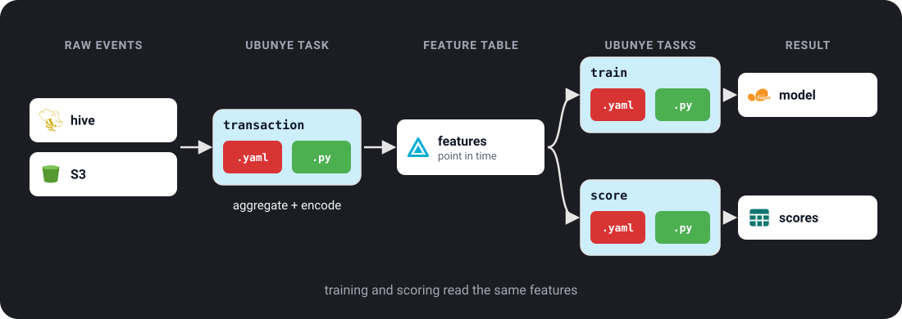

# Pattern: Feature Store Pipeline

For anyone who trains and scores models on Spark and wants both to use the same
features, computed once.

- **The problem:** the training job and the scoring job each compute "amount
  spent in the last 30 days" in their own way, and the numbers drift apart. Or
  training uses values from after the event it is learning about.
- **When to use it:** more than one model or job needs the same features, or you
  need training sets that only use what was known at the time.
- **The one command:** `ubunye run -d pipelines -u fraud -p features -t transaction -m PROD`

A **feature** is one input column for a model, such as a customer's spend over
30 days. A **feature store** here is just a table of features (Delta, or Unity
Catalog) that training and scoring both read.

---

## Architecture



Three tasks in one pipeline, `features`:

```
pipelines/                         # the pipelines folder (-d)
└── fraud/                         # use case (-u)
    └── features/                  # pipeline (-p)
        ├── transaction/           # task: raw events -> feature table
        │   ├── config.yaml
        │   └── transformations.py
        ├── training_set/          # task: features as of each label's time
        │   ├── config.yaml
        │   └── transformations.py
        └── score_features/        # task: each customer's latest features
            ├── config.yaml
            └── transformations.py
```

---

## Feature computation task

```yaml
# pipelines/fraud/features/transaction/config.yaml
MODEL: etl
VERSION: "1.0.0"

ENGINE:
  profiles:
    DEV:
      spark_conf:
        spark.sql.shuffle.partitions: "4"
    PROD:
      spark_conf:
        spark.sql.shuffle.partitions: "400"

CONFIG:
  inputs:
    raw_transactions:
      format: hive
      db_name: raw
      tbl_name: transactions

    customer_profiles:
      format: hive
      db_name: raw
      tbl_name: customers

  outputs:
    transaction_features:
      format: delta
      path: s3://datalake/features/transaction/
      mode: overwrite
```

`transformations.py`:

```python
from pyspark.sql import functions as F, Window
from ubunye.core.interfaces import Task

class FeatureTask(Task):
    def transform(self, sources: dict) -> dict:
        txn = sources["raw_transactions"]
        cust = sources["customer_profiles"]

        # Rolling 30-day aggregations
        w30 = (
            Window.partitionBy("customer_id")
                  .orderBy(F.col("event_ts").cast("long"))
                  .rangeBetween(-30 * 86400, 0)
        )

        features = (
            txn.withColumn("amount_sum_30d", F.sum("amount").over(w30))
               .withColumn("txn_count_30d",  F.count("*").over(w30))
               .withColumn("avg_amount_30d",  F.avg("amount").over(w30))
               .join(cust.select("customer_id", "risk_segment"), "customer_id", "left")
               .withColumn("risk_encoded",
                   F.when(F.col("risk_segment") == "HIGH", 2)
                    .when(F.col("risk_segment") == "MED",  1)
                    .otherwise(0))
               .select(
                   "customer_id", "event_ts",
                   "amount_sum_30d", "txn_count_30d", "avg_amount_30d",
                   "risk_encoded",
               )
        )

        return {"transaction_features": features}
```

Check it, then run it:

```bash
ubunye plan -d pipelines -u fraud -p features -t transaction
ubunye run  -d pipelines -u fraud -p features -t transaction           # DEV profile
ubunye run  -d pipelines -u fraud -p features -t transaction -m PROD   # PROD profile
```

`-m` picks the profile, and with it the Spark settings above (see
[Engine](../config/engine.md)). What success looks like:

```
Task fraud/features/transaction
  Inputs
    customer_profiles hive           raw.customers
                 not checked (not a local path)
    raw_transactions hive           raw.transactions
                 not checked (not a local path)
  Transform  FeatureTask  (transformations.py), written for pyspark
  Outputs
    transaction_features delta          s3://datalake/features/transaction/
                 mode overwrite

Plan OK: 1 task(s) can run.
Starting task: transaction (Mode: DEV, Deploy: client)
[OK] Run complete for transaction
```

The feature table has one row per transaction, with that moment's 30-day numbers:

```
customer_id            event_ts  amount_sum_30d  txn_count_30d  avg_amount_30d  risk_encoded
         c1 2026-10-03 11:51:20          427.41              1      427.410000             2
         c1 2026-10-03 18:15:18          576.43              2      288.215000             2
         c1 2026-10-06 22:00:18         1089.37              3      363.123333             2
```

!!! tip "Try it on your laptop"
    The output above came from a local Spark run with the two Hive inputs and the
    Delta output swapped for Parquet files (`format: s3`, `file_format: parquet`,
    a local `path:`). The transform did not change. `event_ts` must be a Spark
    `TIMESTAMP`: a `TIMESTAMP_NTZ` column (what pandas writes for a time with no
    time zone) cannot be cast to `long` for the 30-day window.

---

## Point-in-time correct feature lookup

For training, join features to labels **as of the label timestamp**: each label
gets the features as they were just before it, never values from later. This is
what **point-in-time correct** means.

```yaml
# pipelines/fraud/features/training_set/config.yaml
CONFIG:
  inputs:
    features:
      format: delta
      path: s3://datalake/features/transaction/

    labels:
      format: hive
      db_name: ml
      tbl_name: fraud_labels

  outputs:
    training_set:
      format: delta
      path: s3://datalake/ml/training_sets/fraud/
      mode: overwrite
```

`transformations.py`:

```python
from pyspark.sql import functions as F
from ubunye.core.interfaces import Task

class TrainingSetTask(Task):
    def transform(self, sources: dict) -> dict:
        features = sources["features"]
        labels   = sources["labels"]

        # Asof join: latest feature snapshot before the label timestamp
        # (the feature table's timestamp column is event_ts)
        training_set = (
            labels.join(features, "customer_id")
                  .filter(F.col("event_ts") <= F.col("label_ts"))
                  .groupBy("customer_id", "label_ts", "is_fraud")
                  .agg(F.max("event_ts").alias("event_ts"))
                  .join(features, ["customer_id", "event_ts"])
        )
        return {"training_set": training_set}
```

Run it after `transaction`:

```bash
ubunye run -d pipelines -u fraud -p features -t training_set
```

What success looks like: one row per label, with the features from the latest
transaction before `label_ts`:

```
customer_id            event_ts   label_ts  is_fraud  amount_sum_30d  txn_count_30d  avg_amount_30d  risk_encoded
         c1 2026-11-04 10:49:55 2026-11-05         1         8584.19             21      408.770952             2
         c2 2026-11-04 22:24:43 2026-11-06         0         5231.07             13      402.390000             1
         c3 2026-11-03 14:24:42 2026-11-07         0         9248.64             18      513.813333             0
```

---

## Serving latest features for scoring

```yaml
# pipelines/fraud/features/score_features/config.yaml
CONFIG:
  inputs:
    features:
      format: delta
      path: s3://datalake/features/transaction/

  outputs:
    latest_features:
      format: delta
      table: main.fraud.latest_features
      mode: overwrite
```

`transformations.py`:

```python
from pyspark.sql import functions as F
from ubunye.core.interfaces import Task

class LatestFeaturesTask(Task):
    def transform(self, sources: dict) -> dict:
        df = sources["features"]
        values = [c for c in df.columns if c != "customer_id"]
        latest = df.groupBy("customer_id").agg(
            F.max_by(F.struct(*values), "event_ts").alias("latest")
        ).select("customer_id", "latest.*")
        return {"latest_features": latest}
```

`values` leaves out `customer_id`: it is already the group key, and selecting it
twice fails with `COLUMN_ALREADY_EXISTS`.

```bash
ubunye run -d pipelines -u fraud -p features -t score_features
```

What success looks like: one row per customer:

```
customer_id            event_ts  amount_sum_30d  txn_count_30d  avg_amount_30d  risk_encoded
         c1 2026-11-05 01:28:32         9059.56             22      411.798182             2
         c2 2026-11-09 05:42:13         6207.21             14      443.372143             1
         c3 2026-11-03 14:24:42         9248.64             18      513.813333             0
```

---

## Schedule with Airflow

Add an `ORCHESTRATION` block to the task's `config.yaml` and export a DAG. Every
key and flag is on [Orchestration](../config/orchestration.md).

```yaml
ORCHESTRATION:
  type: airflow
  schedule: "0 1 * * *"   # 01:00 UTC, runs before the training job at 02:00
  retries: 2
  tags: [features, fraud]
```

```bash
ubunye export airflow \
    -c pipelines/fraud/features/transaction/config.yaml \
    -o dags/fraud_features.py --profile PROD
```
