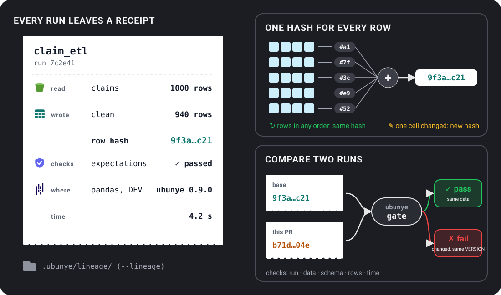

# Gate pull requests on the run record

For anyone who reviews changes to tasks and wants CI to catch a change that
quietly alters the data.

- **The problem:** a small code change can change a task's output, its row
  count or its speed, and nobody notices in review.
- **When to use it:** on every pull request that touches a task, or any time you
  want to compare two runs of the same task.
- **The one command:** `ubunye gate -d pipelines -u shop -p orders -t clean`

`ubunye gate` compares a run's [run record](../guides/run-records.md) (the
record a run leaves with `--lineage`) with a baseline run, and fails when the
new run is worse. In CI the baseline is the task run on the pull request's base
branch, and the candidate is the same task run on its head.



```bash
ubunye gate -d pipelines -u shop -p orders -t clean                     # previous run vs latest
ubunye gate --baseline base.json --candidate head.json                  # two exported records
ubunye gate ... --max-slowdown 0.5 --max-row-change 0.1 --summary "$GITHUB_STEP_SUMMARY"
```

`--baseline` and `--candidate` take a run record file (`ubunye lineage show
--json` writes one), a run id (or its first characters), `previous` or `latest`.

Stored runs are read from the same run record store `ubunye run --lineage`
wrote to, set with the same `--lineage-backend` and `--lineage-dir` flags. See
[Where run records are stored](../cli.md#where-run-records-are-stored).

## What fails the gate

| Rule | Fails when |
|---|---|
| run | the candidate run did not succeed |
| expectation | a `fail` [expectation](../config/expectations.md) was broken |
| data | an output's data changed and the task's `VERSION` did not |
| schema | an output's columns or types changed and `VERSION` did not |
| output | an output is missing from the candidate |
| time | slower than the baseline by more than `--max-slowdown` (runs under 1 s are noise), or longer than `--max-seconds` |
| rows | an output's row count moved by more than `--max-row-change` |

A deliberate change bumps `VERSION` in the task's `config.yaml`, or passes
`--allow-data-change` (then it warns). Every changed output also says what else
changed between the runs (config, code, environment, which inputs); a change
with none of them is reported as a transform that is not deterministic. An input
whose source changed between its read and its hash (`source_changed` in the
record) is named as a possible cause too: its hash is of a later state, so it
cannot show the input was the same.

Warnings never fail the gate: a `warn` expectation broken, rows quarantined, a
new output, hashes that cannot be compared (a record from before 0.7.0, or an
unreadable output), an input whose source changed during the run.

Exit code 1 when the gate fails; `--json` prints the findings; `--summary FILE`
appends a Markdown table.

## The GitHub Action

```yaml
on: pull_request

jobs:
  gate:
    runs-on: ubuntu-latest
    steps:
      - uses: actions/checkout@v4
      - uses: ubunye-ai-ecosystems/ubunye_engine/.github/actions/gate@v0.9.0
        with:
          usecase-dir: pipelines
          usecase: shop
          package: orders      # the pipeline (-p)
          task: clean
          gate-args: --max-slowdown 0.5
```

It installs the engine, runs the task on the pull request's base and on its head
(pandas by default, no Java needed), gates head against base, and writes the
table to the job summary. Inputs: `backend`, `engine` (a pip requirement),
`extra-packages`, `baseline-ref` (default: the pull request's base), `gate-args`,
`llm-mode` (see [Tasks that call a model](#tasks-that-call-a-model)),
`python-version`. Output: `passed`. The `package` input names the pipeline; it
keeps its old name.

## Gate on a number: accuracy, agreement, error rate

`ubunye gate` compares two runs' outputs. To fail a run when a number crosses a line
(a model's accuracy, an LLM's agreement with a label), write the number as an output
and put an expectation on it. The run fails, and writes nothing, before the gate is
even asked:

```yaml
CONFIG:
  outputs:
    metrics:
      format: s3
      path: "{{ task_dir }}/output/metrics"
      file_format: parquet
  expectations:
    metrics:
      rules:
        - between: {column: agreement, min: 0.7}
```

```python
return {"labelled": labelled, "metrics": pd.DataFrame({"agreement": [agreement]})}
```

## Tasks that call a model

For a task that calls a language model (`ubunye.llm`), the gate reports the calls:
how many, how many replayed, the tokens, and their cost at list prices. Two more
rules:

| Flag | Fails when |
| --- | --- |
| `--require-replay` | Any of the candidate's model calls went live instead of replaying. |
| `--max-llm-cost-increase 0.2` | The model bill grew by more than 20%: the list price of the recorded tokens, or the tokens themselves when a model has no price. |

The cost is measured from the recorded tokens, so it works on replayed runs, which
spend nothing. The Action's `llm-mode` input (default `replay`) sets
`UBUNYE_LLM_MODE` for both runs: a pull request is gated on the committed answers,
with no key and no spend, and a changed prompt fails the run closed until its
answers are recorded again.
