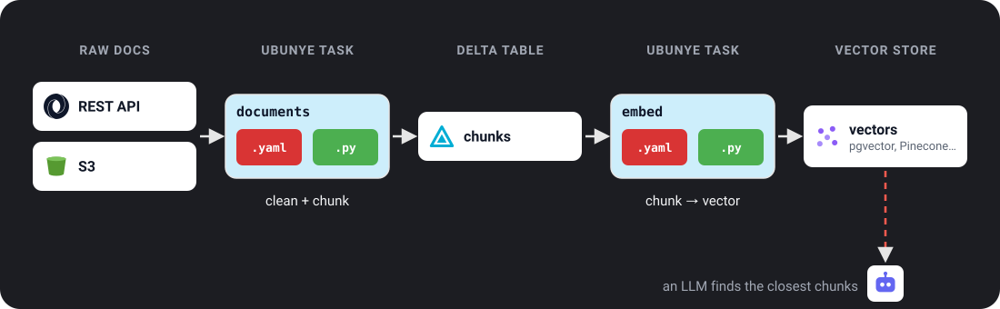

# Pattern: RAG Document Pipeline

For anyone building the data side of a chat assistant that answers from your
own documents.

- **The problem:** an LLM (a large language model, such as the one behind a chat
  assistant) can only quote your documents if they are cleaned, cut into small
  pieces, and turned into numbers it can search. That prep work has to rerun
  every night as documents change.
- **When to use it:** you have articles, policies or pages in an API, a bucket or
  a database, and you want a table of searchable pieces (**chunks**) with an
  **embedding** each (a list of numbers that places similar text close together).
  This is the first half of **RAG** (Retrieval-Augmented Generation): at question
  time, your app finds the closest chunks and hands them to the LLM.
- **The one command:** `ubunye run -d pipelines -u rag -p embed -t chunks --lineage`

The guide runs on your laptop on the pandas backend, with three sample articles
and a stand-in embedder that needs no network. Every output below is real.

---

## Architecture



Three tasks, one after the other:

| Task | Reads | Writes |
|---|---|---|
| `rag/ingest/documents` | raw articles (HTML) | `raw_documents`: clean text, one row per article |
| `rag/chunk/documents` | `raw_documents` | `chunks`: one row per piece of an article |
| `rag/embed/chunks` | `chunks` | `embedded_chunks`: each chunk with its embedding |

```
project/
├── lake/rag/articles.jsonl        # sample input; on a real lake, an API or a bucket
└── pipelines/                     # the pipelines folder (-d)
    └── rag/                       # use case
        ├── ingest/documents/      # config.yaml + transformations.py
        ├── chunk/documents/
        └── embed/chunks/
```

??? note "Sample input (`lake/rag/articles.jsonl`)"
    One JSON object per line (JSON Lines), the shape both pandas and Spark read:

    ```json
    {"id": "a1", "title": "Applying for a bursary", "url": "https://example.org/a1", "published_at": "2026-10-01", "body": "<h1>Applying for a bursary</h1><p>Most bursaries open in <b>March</b> and close in <b>August</b>. You need your Grade 11 results, a copy of your ID and proof of household income.</p><p>Apply to more than one bursary. Keep copies of every form you send, and write down the date you sent it.</p>"}
    {"id": "a2", "title": "Getting an ID", "url": "https://example.org/a2", "published_at": "2026-10-03", "body": "<h1>Getting an ID</h1><p>Go to a Home Affairs office with your birth certificate. If you are under 18, a parent or guardian must come with you.</p><p>The first smart ID card is free. Bring a black pen and arrive early; queues are shorter in the morning.</p>"}
    {"id": "a3", "title": "Short", "url": "https://example.org/a3", "published_at": "2026-10-04", "body": "<p>Too short.</p>"}
    ```

---

## Step 1: Ingest and clean

```yaml
# pipelines/rag/ingest/documents/config.yaml
MODEL: etl
VERSION: "1.0.0"

CONFIG:
  inputs:
    raw_docs:
      format: s3
      path: lake/rag/articles.jsonl
      file_format: json

  transform:
    params:
      min_chars: 100

  outputs:
    raw_documents:
      format: s3
      path: lake/rag/raw_documents
      file_format: parquet
      mode: overwrite
```

```python
# pipelines/rag/ingest/documents/transformations.py
import html
import re

from ubunye.core.interfaces import Task

TAG = re.compile(r"<[^>]+>")
SPACE_BEFORE_MARK = re.compile(r"\s+([.,;:!?])")


def strip_html(body: str) -> str:
    """Drop HTML tags, decode &amp; and friends, squash spaces."""
    text = " ".join(html.unescape(TAG.sub(" ", body)).split())
    return SPACE_BEFORE_MARK.sub(r"\1", text)


class IngestTask(Task):
    def transform(self, sources: dict) -> dict:
        min_chars = self.config["CONFIG"]["transform"]["params"]["min_chars"]
        df = sources["raw_docs"].copy()
        df["text"] = df["body"].map(strip_html)
        df = df[df["text"].str.len() >= min_chars]
        return {"raw_documents": df[["id", "title", "text", "published_at", "url"]]}
```

Article `a3` is shorter than `min_chars`, so it is dropped.

??? example "Read the articles from a REST API instead"
    Swap the input for a `rest_api` one. The token comes from a secret, never
    from the file:

    ```yaml
      inputs:
        raw_docs:
          format: rest_api
          url: "https://content-api.example.com/v1/articles"
          auth:
            type: bearer
            token: "secret://env/CONTENT_API_TOKEN"
          pagination:
            type: next_link
            next_key: next
          response:
            root_key: articles
    ```

    Every REST key is on [REST API Connector](../connectors/rest_api.md);
    secrets are on [Secrets](../config/secrets.md).

---

## Step 2: Cut into chunks

Each chunk is `chunk_words` words long and shares `overlap_words` words with the
one before, so a sentence cut in two still appears whole in one of them. Real
pipelines use 200 to 500 words; the sample uses 20 so you can see the overlap.

```yaml
# pipelines/rag/chunk/documents/config.yaml
MODEL: etl
VERSION: "1.0.0"

CONFIG:
  inputs:
    raw_documents:
      format: s3
      path: lake/rag/raw_documents
      file_format: parquet

  transform:
    params:
      chunk_words: 20
      overlap_words: 5

  outputs:
    chunks:
      format: s3
      path: lake/rag/chunks
      file_format: parquet
      mode: overwrite
```

```python
# pipelines/rag/chunk/documents/transformations.py
import pandas as pd

from ubunye.core.interfaces import Task


def chunk_words(text: str, size: int, overlap: int) -> list:
    """Split text into windows of `size` words that share `overlap` words."""
    words = text.split()
    step = size - overlap
    return [" ".join(words[i : i + size]) for i in range(0, max(len(words) - overlap, 1), step)]


class ChunkTask(Task):
    def transform(self, sources: dict) -> dict:
        p = self.config["CONFIG"]["transform"]["params"]
        rows = []
        for doc in sources["raw_documents"].itertuples():
            for i, text in enumerate(chunk_words(doc.text, p["chunk_words"], p["overlap_words"])):
                rows.append({"doc_id": doc.id, "chunk_index": i, "text": text})
        return {"chunks": pd.DataFrame(rows)}
```

Every chunk keeps its `doc_id`, so you can always tell which article it came from.

---

## Step 3: Embed

The embedder is called straight from the task. The sample uses a stand-in that
needs no network and no key; swap its body for your provider's call.

```yaml
# pipelines/rag/embed/chunks/config.yaml
MODEL: etl
VERSION: "1.0.0"

CONFIG:
  inputs:
    chunks:
      format: s3
      path: lake/rag/chunks
      file_format: parquet

  outputs:
    embedded_chunks:
      format: s3
      path: lake/rag/embedded_chunks
      file_format: parquet
      mode: overwrite
```

```python
# pipelines/rag/embed/chunks/transformations.py
import hashlib

from ubunye.core.interfaces import Task

DIM = 8  # a real model gives 384 to 3072 numbers per chunk


def embed(texts: list) -> list:
    """Stand-in embedder: no network, same text always gives the same vector.

    Swap the body for your provider's call, for example
    client.embeddings.create(model="text-embedding-3-small", input=texts).
    """
    vectors = []
    for t in texts:
        digest = hashlib.sha256(t.encode()).digest()
        vectors.append([round(b / 255, 3) for b in digest[:DIM]])
    return vectors


class EmbedChunks(Task):
    def transform(self, sources: dict) -> dict:
        df = sources["chunks"].copy()
        df["embedding"] = embed(df["text"].tolist())
        return {"embedded_chunks": df}
```

To load the vectors into a vector store (pgvector, a Databricks Vector Search
index, and so on), point `embedded_chunks` at it, or let the store sync from this table.

!!! note "Using a model class instead"
    If you wrap the embedder in a [`UbunyeModel`](../ml/model_contract.md), load it
    from the registry, not from a hand-written path: `register()` it once, then
    `ModelRegistry(store).get_model("rag", "EmbeddingModel", stage=ModelStage.PRODUCTION)`
    returns the path to `load()`. See [Model Registry](../ml/registry.md#python-api).

!!! note "On Spark"
    These transforms are written for pandas. On Spark, use a pandas UDF for
    `strip_html` and `embed`, and `explode` for the chunks. See
    [Writing portable transforms](../guides/portable-transforms.md).

---

## Run it

```bash
ubunye plan -d pipelines -u rag -p ingest -t documents --backend pandas
ubunye run  -d pipelines -u rag -p ingest -t documents --backend pandas --lineage
ubunye run  -d pipelines -u rag -p chunk  -t documents --backend pandas --lineage
ubunye run  -d pipelines -u rag -p embed  -t chunks    --backend pandas --lineage
```

What success looks like:

```
Task rag/ingest/documents   (backend: pandas)
  Inputs
    raw_docs     s3 json        lake/rag/articles.jsonl
                 found: 1 file(s), 910 bytes
  Transform  IngestTask  (transformations.py)
  Outputs
    raw_documents s3 parquet     lake/rag/raw_documents
                 mode overwrite

Plan OK: 1 task(s) can run.
Starting task: documents (Mode: DEV, Deploy: client)
[OK] Run complete for documents
Starting task: documents (Mode: DEV, Deploy: client)
[OK] Run complete for documents
Starting task: chunks (Mode: DEV, Deploy: client)
[OK] Run complete for chunks
```

`lake/rag/embedded_chunks` holds two articles in six chunks:

```
doc_id  chunk_index                                                                                                       text                                                embedding
    a1            0 Applying for a bursary Most bursaries open in March and close in August. You need your Grade 11 results, a [0.165, 0.075, 0.537, 0.569, 0.212, 0.388, 0.337, 0.557]
    a1            1    your Grade 11 results, a copy of your ID and proof of household income. Apply to more than one bursary. [0.298, 0.788, 0.212, 0.718, 0.973, 0.004, 0.714, 0.878]
    a1            2         to more than one bursary. Keep copies of every form you send, and write down the date you sent it. [0.059, 0.306, 0.475, 0.086, 0.278, 0.376, 0.831, 0.294]
    a2            0       Getting an ID Go to a Home Affairs office with your birth certificate. If you are under 18, a parent   [0.49, 0.624, 0.839, 0.816, 0.78, 0.824, 0.835, 0.741]
    a2            1            are under 18, a parent or guardian must come with you. The first smart ID card is free. Bring a [0.698, 0.667, 0.137, 0.255, 0.898, 0.396, 0.231, 0.125]
    a2            2                       card is free. Bring a black pen and arrive early; queues are shorter in the morning.  [0.639, 0.294, 0.29, 0.271, 0.804, 0.706, 0.765, 0.333]
```

---

## What the run records tell you

With `--lineage`, each run leaves a [run record](../guides/run-records.md). A run
record is about **whole tables**, not single documents: for each input and output
it keeps the location, the row count and a hash (a fingerprint) of the data,
plus a hash of your code.

```bash
ubunye lineage list  -d pipelines -u rag -p embed -t chunks
ubunye lineage trace -d pipelines -u rag -p embed -t chunks
```

```
Lineage trace: rag/embed/chunks
Run:     3c9707b4-be1d-4107-bca9-d610880fa800  [success]  2026-11-10T10:40:51
Version: etl v1.0.0

  INPUTS
    [s3] chunks
      location : lake/rag/chunks
      rows     : 6
      ...
  OUTPUTS
    [s3] embedded_chunks
      location : lake/rag/embedded_chunks
      rows     : 6
      ...
```

So the run record answers "which version of the chunks table made this
embeddings table, with which code?". To answer "which article did this chunk
come from?", use the `doc_id` column, which every step keeps.

---

## Run it every night

Add an `ORCHESTRATION` block to each task and export it as an Airflow DAG (a
scheduled job). The keys and the export command are on
[Orchestration](../config/orchestration.md).

```bash
ubunye export airflow -c pipelines/rag/ingest/documents/config.yaml -o dags/rag_ingest.py
ubunye export airflow -c pipelines/rag/chunk/documents/config.yaml  -o dags/rag_chunk.py
ubunye export airflow -c pipelines/rag/embed/chunks/config.yaml     -o dags/rag_embed.py
```
